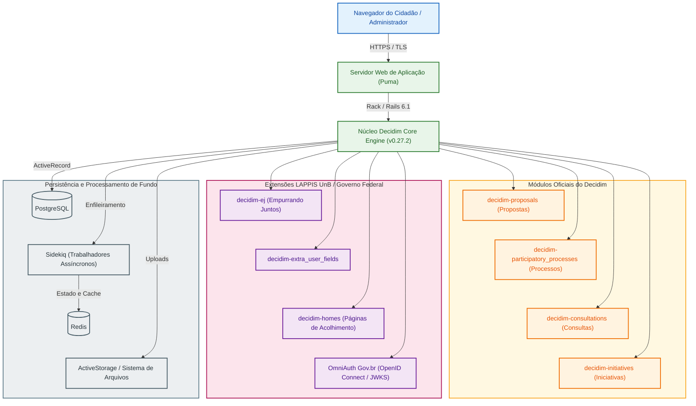

# Entrega 1: Avaliação da Qualidade do Brasil Participativo

**Equipe Frans Bilas (Turma 02)**  
Disciplina: Qualidade de Software 1 (FGA0315 - 2026.2)  
Professora: Dra. Cristiane Soares Ramos  
Campus UnB Gama: Faculdade de Ciências e Tecnologias em Engenharia - Brasília (FCTE)

---

## 1. Visão Geral e Contexto

João V. Farias

<!--
NOTA PARA APRESENTAÇÃO (João):
- Fazer a introdução em 30 segundos.
- O Brasil Participativo é o canal digital oficial do governo federal para deliberação pública (usado no PPA com 1,4 milhão de votos).
- Trata-se de uma instância pública baseada no Decidim (Ruby on Rails), customizada com o LAPPIS da UnB (FCTE).
- O objetivo desta Entrega 1 é fixar as bases normativas: propósito, stakeholders, modelo SQuaRE (ISO 25010:2023) e priorização.
-->

- **Objeto**: Brasil Participativo (software público baseado no Decidim)
- **Origem técnica**: LAPPIS / UnB (FCTE) e Secretaria de Participação Digital
- **Referencial**: ISO/IEC 25010:2023 (SQuaRE) e método Goal-Question-Metric (GQM)
- **Foco da Entrega 1**: Propósito, mapeamento de stakeholders, arquitetura e modelo de qualidade

---

## 2. Avaliação e Propósito

João V. Farias

<!--
NOTA PARA APRESENTAÇÃO (João):
- Responder por que estamos avaliando e quem se beneficia.
- Em consultas nacionais, falhas técnicas corroem a legitimidade democrática do processo.
- A avaliação apoia decisões práticas: orienta a equipe do LAPPIS a refatorar módulos complexos, ajuda a segurança na autenticação unificada e subsidia o governo na melhoria dos formulários para o cidadão.
-->

- **Por que avaliar?** Garantir legitimidade democrática, estabilidade sob picos de acesso e integridade do voto
- **Quem utiliza os resultados?** Engenharia do LAPPIS e gestores do Ministério da Gestão (MGI)
- **Decisões técnicas apoiadas**:
  - Priorização de débitos técnicos e refatorações no código Ruby on Rails
  - Endurecimento da segurança na autenticação Gov.br
  - Redução de barreiras de interação e abandono de formulários

---

## 3. Partes Interessadas

João V. Farias

<!--
NOTA PARA APRESENTAÇÃO (João):
- Apresentar os critérios de sucesso específicos para cada grupo:
  1. Cidadão: quer clareza e sigilo (se for burocrático ou duvidoso, ele desiste).
  2. Governo Federal: exige alta disponibilidade (o site não pode cair) e conformidade legal.
  3. LAPPIS: busca manutenibilidade, modularidade e testes estáveis em RSpec.
  4. Disciplina/Professora: rigor na norma ISO 25010 e rastreabilidade total das medições.
-->

- **Cidadão**: Acesso sem barreiras, navegação clara e garantia de sigilo da deliberação
- **Governo Federal (MGI)**: Disponibilidade contínua, conformidade com a LGPD e confiabilidade pública
- **Engenharia (LAPPIS)**: Código modular, facilidade de manutenção e testes automatizados confiáveis
- **Requisitante Acadêmica**: Auditoria sistemática orientada pela ISO/IEC 25010:2023 e método GQM

---

## 4. Arquitetura do Produto

João V. Farias

<!--
NOTA PARA APRESENTAÇÃO (João):
- Guiar a visão do diagrama em 40 segundos:
  1. Topologia: monólito modular estruturado em engines Rails (Ruby 3.0.4 / Rails 6.1.7 / Decidim 0.27.2).
  2. Módulos oficiais: propostas, consultas e processos participativos.
  3. Extensões do LAPPIS: decidim-ej (opinião pública agrupada), campos extras e SSO Gov.br via OpenID Connect com chaves JWKS.
  4. Persistência: PostgreSQL com JSONB, e Redis/Sidekiq para tarefas em segundo plano.
- Concluir ligando a arquitetura às características: o acoplamento dessas extensões afeta manutenibilidade e segurança.
-->

---

## 5. Modelo de Qualidade

Mateus Vinícius Vieira

- **Norma**: ISO/IEC 25010:2023, a Usabilidade foi rebatizada para *Capacidade de Interação*.

1. **Capacidade de Interação**: Adequação aos usuários e facilidade de operação;
2. **Manutenibilidade**: Modularidade, capacidade de modificação e testabilidade do código aberto;
3. **Segurança**: Confidencialidade, integridade e conformidade de acesso.

---

## 6. Seleção e Priorização das Características (Critério 5)

Mateus Vinícius Vieira

- **Critério de Priorização**: Matriz de impacto no interesse público versus risco técnico.
- **Justificativas de Escolha**:
  - **Capacidade de Interação**: Se o cidadão não compreende a interface, a participação democrática é excluída na base.
  - **Segurança**: Processos de consulta e votação exigem proteção contra fraude, adulteração e vazamento de dados pessoais.
  - **Manutenibilidade**: Garante sustentabilidade a longo prazo por equipes públicas e reduz o custo de extensão do Decidim.

---

## 7. Escopo, Profundidade e Objetos de Avaliação (Critério 6)

Mateus Vinícius Vieira

- **O que entra no escopo**:
  - Código-fonte do repositório `decidim-govbr` (análise estática).
  - Fluxos principais de autenticação e envio de propostas.
  - Conformidade das diretrizes de acessibilidade e interação.
- **O que fica de fora**:
  - Testes intrusivos de estresse e penetração na instância de produção do governo (restrição de segurança e autorização).
  - Infraestrutura de nuvem física de hospedagem.

---

## 8. Alinhamento aos ODS — Metas e Indicadores (Critério 7)

Mateus Vinícius Vieira

- **ODS Principal**: **ODS 16 — Paz, Justiça e Instituições Eficazes**.
- **Meta 16.7**: Garantir a tomada de decisão inclusiva, participativa e representativa em todos os níveis.
- **Indicador de Qualidade**: Proporção de cidadãos que concluem o envio de contribuições sem erros de usabilidade e com garantia de integridade das respostas.

---

## 9. Próximos Passos: GQM e Fase 2

A definir (Dupla 2 / 3)

- Estruturação do grafo Goal-Question-Metric para cada uma das três características.
- Formulação das hipóteses e especificação dos procedimentos de medição.
- Preparação do ambiente de coleta estática e instrumentos de avaliação (TCLE).