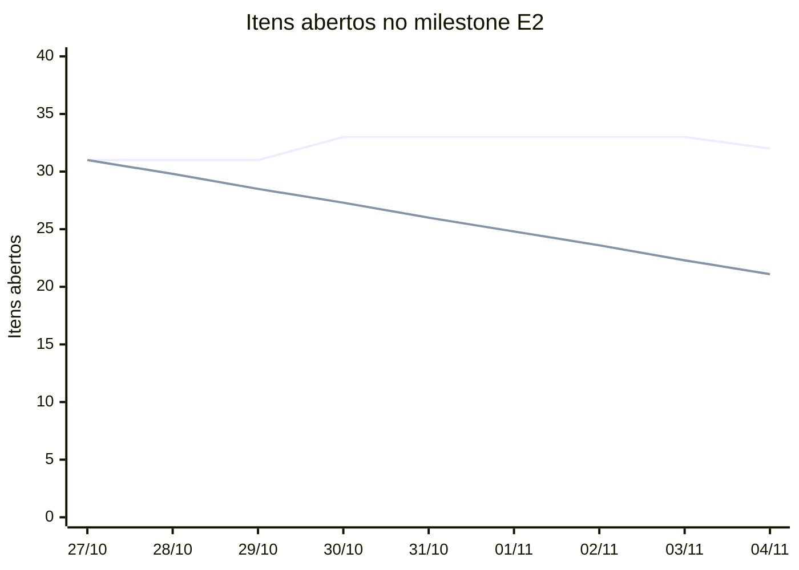

# Métricas de Gestão do Projeto (PSM/CID)

**Equipe Frans Bilas (Turma 01)**  
Disciplina: Qualidade de Software 1 (FGA0315, semestre 2026.2)  
Professora: Dra. Cristiane Soares Ramos  
Apresentação das métricas de gestão: 04/11/2026 ou 11/11/2026

---

## 1. Das Questões do Projeto às Necessidades de Informação

Mateus Vinícius Vieira

<!--
NOTA PARA APRESENTAÇÃO (Mateus):
- Começar pela correção do PC1: a versão 1.0 da Gestão tinha as categorias do PSM, mas não o modelo de informação nem o processo de medição.
- Cada necessidade nasce de uma questão real do projeto, classificada como problema, risco ou falta de informação (McGarry, cap. 2, §2.1).
- Duas necessidades por categoria de informação do PSM.
-->

| Categoria | Necessidade de informação | Questão do projeto que a originou |
| :--- | :--- | :--- |
| Calendário e Progresso | N1: os itens comprometidos no sprint são entregues? | Itens do Sprint 1 fechados na madrugada do prazo (problema) |
| | N2: a Entrega 2 fica pronta até a release de 21/11? | Atraso de um dia custa 50% da nota (risco) |
| Recursos e Custos | N3: a divisão do esforço está equilibrada? | Tabela de contribuição feita por acordo, sem horas (falta de informação) |
| | N4: nossas estimativas são precisas? | Sprints de uma semana e duas melhorias técnicas (risco) |
| Desempenho dos Processos | N5: quanto tempo um item leva do início ao fim? | Trabalho acumulado no fim do sprint (problema) |
| | N6: todo trabalho é revisado por outra dupla? | 39 de 42 integrações na `main` sem PR até 26/10 (problema) |

Fonte: [Gestão, Seção 2](../gestao.md#2-necessidades-de-informacao).

---

## 2. Seleção das Medidas

Mateus Vinícius Vieira

<!--
NOTA PARA APRESENTAÇÃO (Mateus):
- Parte 1 do guia CID: o que medir. Cinco indicadores saíram da tabela ICM e um é adaptação declarada, como o guia permite (CID P1, §5).
- Critérios de seleção da Aula 09: relevância para a necessidade, viabilidade e custo da coleta, grau de intrusão, facilidade de interpretação.
- A Parte 3 (garantia de software e dívida técnica) não entra na gestão da equipe: a Aula 09 a trata como complemento, e o tema dela é o produto.
-->

| Indicador | Origem no guia CID | Por que foi escolhido |
| :--- | :--- | :--- |
| N1 Comprometido × concluído | ICM linha 1; Parte 2, §8.3 | Responde à N1 com contagem simples no quadro |
| N2 Burndown da E2 | ICM linha 1; Parte 2, §8.2 | Mostra o atraso antes do prazo, e não depois |
| N3 Esforço por integrante | ICM linha 7 | Base da tabela de contribuição, que vale nota |
| N4 Estimado × real | ICM linha 8 | Mesmo campo de N3, sem custo extra de coleta |
| N5 Cycle time | ICM linha 32; Parte 2, §8.5 | Duas datas por issue |
| N6 Revisão por pares | Adaptação, próxima da linha 18 | Liga a gestão ao critério de Pronto |

Fonte: [Gestão, Seção 3](../gestao.md#3-indicadores-selecionados).

---

## 3. Instância do Modelo de Informação: N1

Miguel Arthur Oliveira de Lima

<!--
NOTA PARA APRESENTAÇÃO (Miguel):
- Usar o template da Aula 09 com um indicador completo. Os seis construtos estão na Seção 4 da Gestão.
- Destacar o critério de Pronto: só conta como concluído o item fechado por PR revisado por outra dupla e aprovado no humanizer.
-->

| Elemento do construto | N1: comprometido × concluído |
| :--- | :--- |
| Entidade e atributo | Issues do sprint; status no início e no fim |
| Medidas básicas | \(C\) = itens comprometidos; \(D\) = itens concluídos no critério de Pronto |
| Método e unidade | Contagem no GitHub Projects 33; item |
| Medida derivada | \(\%_{\text{concl}} = \frac{D}{C} \times 100\) |
| Modelo de análise | \(\text{Desvio} = 100\% - \%_{\text{concl}}\) |
| Critério de decisão | Desvio acima de 5%: investigar; acima de 10%: ação corretiva (CID P2, §8.3) |
| Produto de informação | Sprint 3: desvio de 94,1%, ação corretiva |

Fonte: [Gestão, Seção 4](../gestao.md#4-construtos-de-medicao).

---

## 4. Coleta e Medição do Sprint 3

Davi Mesquita Sousa

<!--
NOTA PARA APRESENTAÇÃO (Davi):
- A coleta usa os campos do GitHub Projects 33 (status, sprint, esforço estimado e real, início e conclusão) e o histórico da main.
- O script scripts/psm_medicao.py refaz a medição a qualquer momento e grava os dados brutos em dados/gestao/sprint-3.json.
- Medição feita em 04/11, último dia do sprint. Comprometido: as 17 issues da redistribuição de 30/10 (Ata 02).
- N6: 9 integrações na main no sprint, sem contar os commits automáticos do painel; só o PR #92 teve revisão de outra dupla.
-->

| Indicador | Valor no Sprint 3 | Critério |
| :--- | :--- | :--- |
| N1 | 1 de 17 no critério de Pronto (5,9%); 6 de 17 fechadas | Ação corretiva |
| N2 | 32 de 40 itens abertos; 20% concluído com 32% do prazo passado | Replanejar (variância de 12 p.p.) |
| N3, N4, N5 | Sem dado: horas reais e datas em branco nas issues | Não calculável |
| N6 | 1 de 9 integrações revisada por outra dupla (11,1%) | Abaixo de 100% |

Fonte: [Gestão, Seção 12](../gestao.md#12-medicao-do-sprint-3); dados brutos em [`sprint-3.json`](../dados/gestao/sprint-3.json).

---

## 5. Burndown da Entrega 2

Davi Mesquita Sousa

<!--
NOTA PARA APRESENTAÇÃO (Davi):
- A linha de cima são os itens abertos ao fim de cada dia; a de baixo, o ideal até a release de 21/11.
- O escopo cresceu de 33 para 40 itens no sprint (coleta em 30/10 e issues novas em 04/11), por isso a linha sobe.
- Limitação: reconstrução pelo milestone atual e pelas datas de criação e fechamento das issues.
-->

Fonte: [`dados/gestao/sprint-3.json`](../dados/gestao/sprint-3.json).

---

## 6. Do Indicador à Decisão

Mateus Vinícius Vieira

<!--
NOTA PARA APRESENTAÇÃO (Mateus):
- Premissa 3 da especificação: registrar medições, interpretação e decisões.
- A redistribuição já foi aplicada no Projects em 04/11. As outras duas decisões são propostas que a equipe vota na Ata 03 (#94).
-->

| Indicador | Causa | Decisão |
| :--- | :--- | :--- |
| N1 | Dez issues sem nenhum trabalho registrado; PRs sem revisão de outra dupla | Sprints 4 a 6 redistribuídos com uma issue por pessoa (aplicado em 04/11) |
| N2 | Escopo da E2 cresceu 21% | Se a variância passar de 10% em 11/11, a segunda melhoria (#80) sai do escopo (proposta) |
| N3, N4, N5 | Campos não preenchidos ao fechar a issue | Campos obrigatórios antes de fechar (proposta) |
| N6 | `main` ainda aceita commit direto | PR obrigatório com aprovação de outra dupla (#43) |

Fonte: [Gestão, Tabela 16](../gestao.md#12-medicao-do-sprint-3).

---

## 7. Avaliação da Medição

Mateus Vinícius Vieira

<!--
NOTA PARA APRESENTAÇÃO (Mateus):
- Quarta atividade do processo do PSM (McGarry, cap. 1, §1.6): as medidas estão em uso?
- Ponto honesto: o painel automático mostrava valores fixos no código quando o Projects não respondia. Foi a medição que achou a falha, corrigida na #106.
- Lição sobre o critério de intrusão da Aula 09: preencher três campos ao fechar a issue parecia barato, e ninguém preencheu.
-->

- **Em uso**: N1, N2 e N6 tiveram dado e levaram a decisão
- **Sem uso**: N3, N4 e N5 dependem de campos preenchidos à mão. Se continuarem vazios no Sprint 4, o indicador é trocado, com motivo em ata
- **Falha encontrada**: o painel automático usava valores fixos quando o Projects não respondia; corrigido (#106), e o script agora falha em vez de inventar número
- **Próximas medições**: 11/11 (fim do Sprint 4) e 21/11 (release da E2), fechando a série de três sprints

---

## A1. Apêndice: Critérios de Decisão dos Seis Indicadores

Miguel Arthur Oliveira de Lima

<!--
NOTA PARA APRESENTAÇÃO (Miguel):
- Usar só se a professora perguntar pelos critérios.
- Os critérios de N3 e N4 ainda estão em validação pela equipe (Gestão, Seção 10).
-->

| Indicador | Critério de decisão | Origem |
| :--- | :--- | :--- |
| N1 | Desvio acima de 5%: investigar; acima de 10%: ação corretiva | CID P2, §8.3 |
| N2 | Variância acima de 5%: revisar; acima de 10%: replanejar escopo | CID P2, §8.2 |
| N3 | Participação abaixo de 10% ou acima de 25% no sprint: conversa na reunião | Acordo da equipe (em validação) |
| N4 | Precisão fora de 80% a 120%: rever a forma de estimar | Adaptado de CID P2, Fig. 26 (em validação) |
| N5 | Item mais de 10% acima da média: investigar | CID P2, §8.5 |
| N6 | Abaixo de 100%: o item não conta como Pronto e a `main` passa a exigir PR | Construído pela equipe |

Fonte: [Gestão, Seção 4](../gestao.md#4-construtos-de-medicao).

---

## Histórico de Versões

| Versão | Data | Descrição | Autor | Revisor |
| :---: | :---: | :--- | :--- | :--- |
| `1.0` | 04/11/2026 | Slides da apresentação das métricas de gestão (PSM), com a medição do Sprint 3 | [Mateus Vinícius Vieira](https://github.com/matix0) | A definir |
