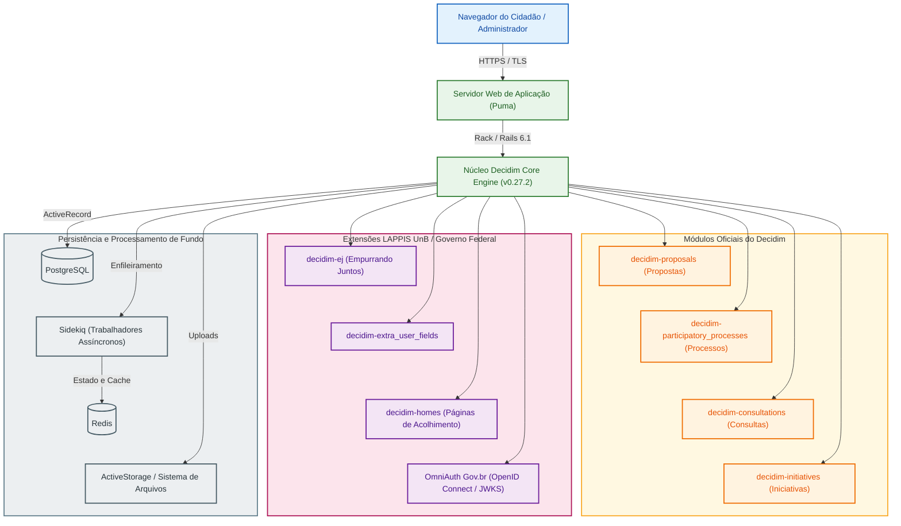

# Fase 1: Planejamento da Avaliação e Modelo de Qualidade

Esta fase documenta o planejamento preliminar da avaliação de qualidade do software **Brasil Participativo**, orientada pela norma **ISO/IEC 25010:2023** e pelo método **Goal-Question-Metric (GQM)**, conforme as diretrizes da disciplina Qualidade de Software 1 (FGA0315 - 2026.2).

---

## 1. Contextualização e Origem do Software (Critério AG-C1)

O **Brasil Participativo** é a plataforma digital oficial do Governo Federal brasileiro voltada à consulta pública, proposição de políticas e deliberação popular. O sistema foi adotado em larga escala durante a elaboração do Plano Plurianual (PPA 2024-2027), registrando mais de 1,4 milhão de votos de cidadãos em todo o país.

A solução é um desdobramento direto de pesquisas aplicadas do **Laboratório Avançado de Pesquisa e Desenvolvimento de Software (LAPPIS)** da Universidade de Brasília (Campus UnB Gama: Faculdade de Ciências e Tecnologias em Engenharia - Brasília / FCTE). O histórico técnico do grupo inclui a experiência com o projeto Noosfero e iniciativas cívicas prévias (Portal do Software Público e Participa.br). Tecnicamente, o Brasil Participativo constitui um *fork* customizado da plataforma livre [Decidim](https://decidim.org/), mantida originariamente pela comunidade de Barcelona. A instância federal agrega integrações específicas com a infraestrutura pública brasileira, incluindo autenticação unificada via Gov.br, componentes de votação segmentada e módulos de análise de opinião cívica desenvolvidos pelo LAPPIS.

---

## 2. Propósito da Avaliação e Uso Pretendido (Critério 1)

**Responsável técnico**: João Victor da Silva Batista de Farias (Dupla 1)

### 2.1 Justificativa da Avaliação

Avaliar a qualidade do Brasil Participativo é necessário devido ao impacto democrático e à escala das consultas públicas conduzidas pela União. Instabilidades, barreiras de acessibilidade ou vulnerabilidades em mecanismos de votação afetam diretamente a legitimidade dos processos participativos. A avaliação busca diagnosticar gargalos técnicos no código-fonte aberto, identificar dívidas técnicas acumuladas nas extensões customizadas e apontar inconformidades com padrões de acessibilidade e segurança.

### 2.2 Uso Pretendido e Decisões Apoiadas

Os resultados obtidos através da medição de produto subsidiarão decisões técnicas e gerenciais concretas:

1. **Priorização de Refatoração no Código Ruby on Rails**: Indicar aos mantenedores do LAPPIS quais módulos internos apresentam alto acoplamento ou baixa cobertura de testes automatizados, orientando os ciclos de manutenção corretiva e preventiva.
2. **Endurecimento de Mecanismos de Autenticação e Autorização**: Apoiar a equipe de segurança da Dataprev e do Ministério da Gestão e da Inovação em Serviços Públicos (MGI) na revisão de permissões de controladores e cabeçalhos de proteção (Content Security Policy).
3. **Redesenho de Fluxos de Interação Cidadã**: Fornecer evidências empíricas à Secretaria de Participação Digital sobre telas, formulários e componentes visuais que causam desistência ou lentidão na submissão de propostas por usuários com menor letramento digital.

---

## 3. Requisitante e Partes Interessadas (Critério 2)

**Responsável técnico**: João Victor da Silva Batista de Farias (Dupla 1)

O mapeamento de partes interessadas identifica os atores envolvidos, suas responsabilidades e os critérios de aceitação que balizam o sucesso da avaliação:

| Parte Interessada | Papel no Contexto do Software | Necessidades Primárias | Critério de Sucesso da Avaliação |
| :--- | :--- | :--- | :--- |
| **Requisitante Acadêmico** (Profa. Cristiane Ramos / UnB) | Demandante da auditoria no contexto acadêmico | Aplicação rigorosa das normas ISO/IEC 25010:2023, GQM e métodos de medição de software | Obtenção de métricas rastreáveis, dados brutos auditáveis e correlação entre as características |
| **Cidadão / Usuário Final** | Participante de consultas, votações e proposição de emendas | Interface compreensível, tempo de resposta baixo e sigilo no voto | Ausência de barreiras operacionais nos formulários e garantia de integridade das propostas enviadas |
| **Equipe de Engenharia / LAPPIS** | Mantenedores do código-fonte e das gems customizadas | Código limpo, desacoplado, modular e com testes automatizados confiáveis | Identificação precisa de módulos com alta complexidade ciclomática e débito técnico mensurável |
| **Órgão Gestor Governamental** (Secretaria de Participação / MGI) | Gestores de políticas públicas e proprietários do serviço | Plataforma estável sob picos de acesso, conformidade com a LGPD e alta confiabilidade | Diagnóstico de segurança sem incidentes e dados para planejar a infraestrutura de futuras consultas |

---

## 4. Tipo de Produto e Descrição Estruturada do Software (Critério 3)

**Responsável técnico**: João Victor da Silva Batista de Farias (Dupla 1)

### 4.1 Classificação do Produto

O Brasil Participativo é classificado como uma **aplicação web transacional para deliberação cívica**, estruturada sob o paradigma de **monólito modular**. A aplicação centraliza a gestão de identidade, armazenamento persistente e renderização web em um único repositório orquestrador (`decidim-govbr`), dividindo suas regras de negócio em motores isolados (*engines* do Ruby on Rails).

### 4.2 Pilha Tecnológica e Dependências

A inspeção do repositório revela a seguinte composição de infraestrutura:

- **Linguagem e Framework**: Ruby 3.0.4 rodando sobre Ruby on Rails 6.1.7.
- **Núcleo de Participação**: Plataforma Decidim versão 0.27.2 (`decidim-core`, `decidim-proposals`, `decidim-participatory_processes`, `decidim-consultations`, `decidim-initiatives`).
- **Camada de Dados**: Banco de dados relacional PostgreSQL, com armazenamento de atributos dinâmicos e metadados em colunas JSONB.
- **Processamento Assíncrono e Cache**: Filas gerenciadas via Sidekiq 6.5.7 apoiadas em memória Redis 4.7 para processamento de notificações, envios de e-mail e exportação de relatórios.
- **Autenticação Unificada**: Integração Single Sign-On (SSO) com a conta Gov.br via protocolo OpenID Connect com verificação de chave criptográfica JWKS (`omniauth_openid_connect` e `omniauth_govbr.rb`).
- **Gems Específicas do Governo Federal**:
  - `decidim-ej`: Módulo de consulta popular estruturada (*Empurrando Juntos*), permitindo agrupamento de opiniões cidadãs.
  - `decidim-extra_user_fields`: Campos cadastrais customizados para validação de identidade e perfil demográfico.
  - `decidim-homes`: Customização de páginas iniciais segmentadas para diferentes campanhas governamentais.
  - `decidim-mobile`: Ajustes para integração e responsividade em visualizações móveis.

## 4.3 Diagrama de Arquitetura do Sistema

---

## 5. Modelo de Qualidade ISO/IEC 25010:2023 (Critério 4)

**Responsável técnico**: Mateus Vinícius Vieira (Dupla 1)

A avaliação usa três características da ISO/IEC 25010:2023. A seleção considera o impacto do produto sobre a participação cidadã e os riscos técnicos observáveis no código e nos fluxos avaliados.

| Característica | Subcaracterísticas consideradas | Aplicação no Brasil Participativo |
| :--- | :--- | :--- |
| **Capacidade de Interação** | Apreensibilidade, operabilidade, proteção contra erros do usuário e inclusividade | Avaliação dos fluxos de autenticação, consulta e envio de propostas |
| **Manutenibilidade** | Modularidade, analisabilidade e testabilidade | Avaliação das extensões que sobrescrevem o núcleo do Decidim e de seus testes |
| **Segurança** | Confidencialidade, integridade, autenticidade e resistência | Avaliação da autenticação, das permissões e das dependências do projeto |

---

## 6. Seleção e Priorização das Características (Critério 5)

**Responsável técnico**: Mateus Vinícius Vieira (Dupla 1)

A equipe priorizou as características com uma matriz qualitativa que cruza impacto no interesse público e risco técnico. O resultado foi:

1. **Capacidade de Interação**: barreiras no fluxo podem impedir a participação de pessoas que não conseguem compreender ou concluir as tarefas.
2. **Segurança**: falhas na autenticação, na autorização ou no tratamento de dados podem comprometer a integridade das contribuições e a proteção dos participantes.
3. **Manutenibilidade**: acoplamento entre extensões e o núcleo do Decidim pode aumentar o esforço de atualização e correção do sistema.

---

## 7. Escopo, Profundidade e Objetos de Avaliação (Critério 6)

**Responsável técnico**: Mateus Vinícius Vieira (Dupla 1)

O escopo combina análise estática do repositório `decidim-govbr` com sessões controladas dos fluxos de participação. Serão examinados:

- classes customizadas que estendem ou sobrescrevem o Decidim, especialmente em `app/permissions/` e `app/commands/`;
- testes automatizados em RSpec relacionados às classes customizadas;
- autenticação via Gov.br, busca de um processo participativo, envio de propostas e apoio a propostas;
- acessibilidade e uso dos fluxos em navegador de computador e celular;
- vulnerabilidades apontadas pelo Brakeman e pelas dependências registradas no `Gemfile.lock`.

Ficam fora do escopo testes intrusivos de carga ou penetração contra a instância de produção, além da infraestrutura física ou de nuvem que hospeda o serviço. As sessões com usuários devem seguir o protocolo de consentimento definido pela equipe.

---

## 8. Alinhamento aos ODS: Metas e Indicadores (Critério 7)

**Responsável técnico**: Mateus Vinícius Vieira (Dupla 1)

O trabalho se relaciona ao **ODS 16, Paz, Justiça e Instituições Eficazes**, em especial à **Meta 16.7**, que trata da tomada de decisão inclusiva, participativa e representativa. A avaliação observa se os fluxos do Brasil Participativo permitem que diferentes cidadãos concluam suas contribuições e se as respostas permanecem protegidas contra alteração indevida.

O indicador operacional será a proporção de participantes que concluem as tarefas definidas sem erro impeditivo, complementada pelos resultados de acessibilidade e pelas verificações de integridade e autorização. Os valores serão coletados nas etapas seguintes; esta fase define a relação entre o objetivo de desenvolvimento e as medidas do projeto.

---

## 9. Fase 2: Objetivos de Medição

José Vinícius Alvares Soares de Queiroz

<!--
NOTA PARA APRESENTAÇÃO (José), cerca de 40 segundos:
- Um objetivo por característica, cada um respondendo a uma decisão do Propósito.
- O ponto de vista é a parte interessada que sente primeiro a falha.
- No código, o decidim-govbr sobrescreve classes do próprio Decidim (commit 176b046); por isso o G2 olha para essas classes.
-->

- **G1, Capacidade de Interação**: barreiras no fluxo de participação, do ponto de vista do **cidadão**
- **G2, Manutenibilidade**: esforço para manter o `decidim-govbr`, do ponto de vista do **LAPPIS**
- **G3, Segurança**: proteção dos dados e das ações, do ponto de vista do **órgão gestor**

---

## 10. Fase 2: Questões e Hipóteses

José Vinícius Alvares Soares de Queiroz

<!--
NOTA PARA APRESENTAÇÃO (José), cerca de 40 segundos:
- Três questões por objetivo, uma por subcaracterística.
- Cada questão tem uma hipótese registrada antes da coleta, por exemplo a H1.1.
- As métricas e os níveis de julgamento estão especificados na [Fase 2](2.md).
-->

| Objetivo | Questões |
| :--- | :--- |
| G1 | Conclui sem ajuda? Corrige erros? Acessível? |
| G2 | Sobrescritas concentradas? Fácil de mudar? Testado? |
| G3 | Vulnerabilidades? Dependências? Permissões? |

- Uma hipótese por questão. Exemplo: ao menos 80% concluem as tarefas sem ajuda

---

## Histórico de Versões

| Versão | Data | Descrição | Autor | Revisor |
| :---: | :---: | :--- | :--- | :--- |
| `1.0` | 17/10/2026 | Estruturação da Fase 1, contextualização, propósito, stakeholders e arquitetura | [João Victor da Silva Batista de Farias](https://github.com/beyondmagic) | [Mateus Vinícius Vieira](https://github.com/matix0) |
| `1.1` | 18/10/2026 | Correção da versão do Rails (6.1.7.2) e remoção da numeração de critérios nos títulos | [José Vinícius Alvares Soares de Queiroz](https://github.com/JoseViniciusQueiroz) | A definir |
