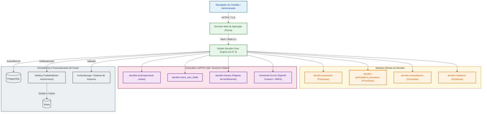

# Fase 1: Planejamento da Avaliação e Modelo de Qualidade

Esta fase documenta o planejamento preliminar da avaliação de qualidade do software **Brasil Participativo**, orientada pela norma **ISO/IEC 25010:2023** e pelo método **Goal-Question-Metric (GQM)**, conforme as diretrizes da disciplina Qualidade de Software 1 (FGA0315 - 2026.2).

---

## 1. Contextualização e Origem do Software (Critério AG-C1)

O **Brasil Participativo** é a plataforma digital oficial do Governo Federal brasileiro voltada à consulta pública, proposição de políticas e deliberação popular. O sistema foi adotado em larga escala durante a elaboração do Plano Plurianual (PPA 2024-2027), registrando mais de 1,4 milhão de votos de cidadãos em todo o país.

A solução é um desdobramento direto de pesquisas aplicadas do **Laboratório Avançado de Pesquisa e Desenvolvimento de Software (LAPPIS)** da Universidade de Brasília (Campus UnB Gama: Faculdade de Ciências e Tecnologias em Engenharia - Brasília / FCTE). O histórico técnico do grupo inclui a experiência com o projeto Noosfero e iniciativas cívicas prévias (Portal do Software Público e Participa.br). Tecnicamente, o Brasil Participativo constitui um *fork* customizado da plataforma livre [Decidim](https://decidim.org/), mantida originariamente pela comunidade de Barcelona. A instância federal agrega integrações específicas com a infraestrutura pública brasileira, incluindo autenticação unificada via Gov.br, componentes de votação segmentada e módulos de análise de opinião cívica desenvolvidos pelo LAPPIS.

---

## 2. Propósito da Avaliação e Uso Pretendido (Critério 1)

**Responsável técnico**: João Victor da Silva Batista de Farias (Dupla 1)

### 2.1 Justificativa da Avaliação

Avaliar a qualidade do Brasil Participativo é necessário devido ao impacto democrático e à escala das consultas públicas conduzidas pela União. Instabilidades, barreiras de acessibilidade ou vulnerabilidades em mecanismos de votação afetam diretamente a legitimidade dos processos participativos. A avaliação busca diagnosticar gargalos técnicos no código-fonte aberto, identificar dívidas técnicas acumuladas nas extensões customizadas e apontar inconformidades com padrões de acessibilidade e segurança.

### 2.2 Uso Pretendido e Decisões Apoiadas

Os resultados obtidos através da medição de produto subsidiarão decisões técnicas e gerenciais concretas:

1. **Priorização de Refatoração no Código Ruby on Rails**: Indicar aos mantenedores do LAPPIS quais módulos internos apresentam alto acoplamento ou baixa cobertura de testes automatizados, orientando os ciclos de manutenção corretiva e preventiva.
2. **Endurecimento de Mecanismos de Autenticação e Autorização**: Apoiar a equipe de segurança da Dataprev e do Ministério da Gestão e da Inovação em Serviços Públicos (MGI) na revisão de permissões de controladores e cabeçalhos de proteção (Content Security Policy).
3. **Redesenho de Fluxos de Interação Cidadã**: Fornecer evidências empíricas à Secretaria de Participação Digital sobre telas, formulários e componentes visuais que causam desistência ou lentidão na submissão de propostas por usuários com menor letramento digital.

---

## 3. Requisitante e Partes Interessadas (Critério 2)

**Responsável técnico**: João Victor da Silva Batista de Farias (Dupla 1)

O mapeamento de partes interessadas identifica os atores envolvidos, suas responsabilidades e os critérios de aceitação que balizam o sucesso da avaliação:

| Parte Interessada | Papel no Contexto do Software | Necessidades Primárias | Critério de Sucesso da Avaliação |
| :--- | :--- | :--- | :--- |
| **Requisitante Acadêmico** (Profa. Cristiane Ramos / UnB) | Demandante da auditoria no contexto acadêmico | Aplicação rigorosa das normas ISO/IEC 25010:2023, GQM e métodos de medição de software | Obtenção de métricas rastreáveis, dados brutos auditáveis e correlação entre as características |
| **Cidadão / Usuário Final** | Participante de consultas, votações e proposição de emendas | Interface compreensível, tempo de resposta baixo e sigilo no voto | Ausência de barreiras operacionais nos formulários e garantia de integridade das propostas enviadas |
| **Equipe de Engenharia / LAPPIS** | Mantenedores do código-fonte e das gems customizadas | Código limpo, desacoplado, modular e com testes automatizados confiáveis | Identificação precisa de módulos com alta complexidade ciclomática e débito técnico mensurável |
| **Órgão Gestor Governamental** (Secretaria de Participação / MGI) | Gestores de políticas públicas e proprietários do serviço | Plataforma estável sob picos de acesso, conformidade com a LGPD e alta confiabilidade | Diagnóstico de segurança sem incidentes e dados para planejar a infraestrutura de futuras consultas |

---

## 4. Tipo de Produto e Descrição Estruturada do Software (Critério 3)

**Responsável técnico**: João Victor da Silva Batista de Farias (Dupla 1)

### 4.1 Classificação do Produto

O Brasil Participativo é classificado como uma **aplicação web transacional para deliberação cívica**, estruturada sob o paradigma de **monólito modular**. A aplicação centraliza a gestão de identidade, armazenamento persistente e renderização web em um único repositório orquestrador (`decidim-govbr`), dividindo suas regras de negócio em motores isolados (*engines* do Ruby on Rails).

### 4.2 Pilha Tecnológica e Dependências

A inspeção do repositório revela a seguinte composição de infraestrutura:

- **Linguagem e Framework**: Ruby 3.0.4 rodando sobre Ruby on Rails 6.1.7.
- **Núcleo de Participação**: Plataforma Decidim versão 0.27.2 (`decidim-core`, `decidim-proposals`, `decidim-participatory_processes`, `decidim-consultations`, `decidim-initiatives`).
- **Camada de Dados**: Banco de dados relacional PostgreSQL, com armazenamento de atributos dinâmicos e metadados em colunas JSONB.
- **Processamento Assíncrono e Cache**: Filas gerenciadas via Sidekiq 6.5.7 apoiadas em memória Redis 4.7 para processamento de notificações, envios de e-mail e exportação de relatórios.
- **Autenticação Unificada**: Integração Single Sign-On (SSO) com a conta Gov.br via protocolo OpenID Connect com verificação de chave criptográfica JWKS (`omniauth_openid_connect` e `omniauth_govbr.rb`).
- **Gems Específicas do Governo Federal**:
  - `decidim-ej`: Módulo de consulta popular estruturada (*Empurrando Juntos*), permitindo agrupamento de opiniões cidadãs.
  - `decidim-extra_user_fields`: Campos cadastrais customizados para validação de identidade e perfil demográfico.
  - `decidim-homes`: Customização de páginas iniciais segmentadas para diferentes campanhas governamentais.
  - `decidim-mobile`: Ajustes para integração e responsividade em visualizações móveis.

## 4.3 Diagrama de Arquitetura do Sistema

---

## 5. Modelo de Qualidade ISO/IEC 25010:2023 (Critério 4)

**Responsável técnico**: Mateus Vinícius Vieira (Dupla 1)

*Seção em desenvolvimento. Esta seção apresentará o modelo adaptado da norma ISO/IEC 25010:2023, o diagrama conceitual hierárquico ligando as características às suas subcaracterísticas e a justificativa metodológica da adaptação ao contexto do Brasil Participativo.*

---

## 6. Seleção e Priorização das Características (Critério 5)

**Responsável técnico**: Mateus Vinícius Vieira (Dupla 1)

*Seção em desenvolvimento. Esta seção detalhará a matriz de priorização formal (impacto x risco) que fundamentou a escolha das três características centrais da avaliação:*
1. *Capacidade de Interação (Interaction Capability)*
2. *Manutenibilidade (Maintainability)*
3. *Segurança (Security)*

---

## 7. Escopo, Profundidade e Objetos de Avaliação (Critério 6)

**Responsável técnico**: Mateus Vinícius Vieira (Dupla 1)

*Seção em desenvolvimento. Esta seção delimitará com precisão quais componentes do código-fonte e quais fluxos de usuário serão submetidos à análise estática e a testes empíricos, além de justificar o que fica expressamente fora do escopo neste momento.*

---

## 8. Alinhamento aos ODS — Metas e Indicadores (Critério 7)

**Responsável técnico**: Mateus Vinícius Vieira (Dupla 1)

*Seção em desenvolvimento. Esta seção conectará a avaliação aos Objetivos de Desenvolvimento Sustentável da ONU, em especial ao ODS 16 (Paz, Justiça e Instituições Eficazes) e sua Meta 16.7 (tomada de decisão inclusiva e participativa).*

