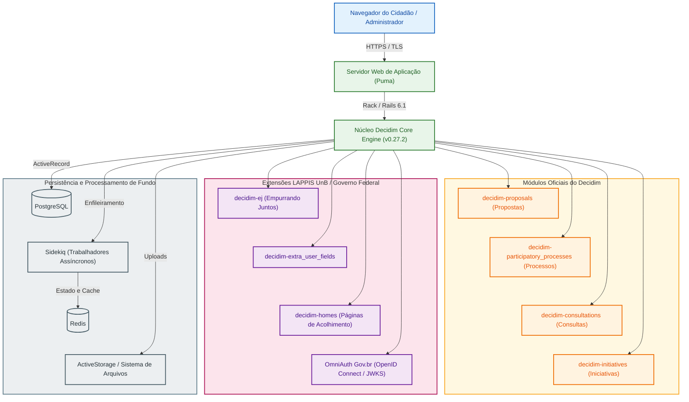

# Fase 1: Planejamento da Avaliação e Modelo de Qualidade

Esta fase documenta o planejamento preliminar da avaliação de qualidade do software **Brasil Participativo**, orientada pela norma **ISO/IEC 25010:2023** e pelo método **Goal-Question-Metric (GQM)**, conforme as diretrizes da disciplina Qualidade de Software 1 (FGA0315 - 2026.2).

---

## 1. Contextualização e Origem do Software 

O **Brasil Participativo** é a plataforma digital oficial do Governo Federal brasileiro voltada à consulta pública, proposição de políticas e deliberação popular. O sistema foi adotado em larga escala durante a elaboração do Plano Plurianual (PPA 2024-2027), registrando mais de 1,4 milhão de votos de cidadãos em todo o país.

A solução é um desdobramento direto de pesquisas aplicadas do **Laboratório Avançado de Pesquisa e Desenvolvimento de Software (LAPPIS)** da Universidade de Brasília (Campus UnB Gama: Faculdade de Ciências e Tecnologias em Engenharia - Brasília / FCTE). O histórico técnico do grupo inclui a experiência com o projeto Noosfero e iniciativas cívicas prévias (Portal do Software Público e Participa.br). Tecnicamente, o Brasil Participativo constitui um *fork* customizado da plataforma livre [Decidim](https://decidim.org/), mantida originariamente pela comunidade de Barcelona. A instância federal agrega integrações específicas com a infraestrutura pública brasileira, incluindo autenticação unificada via Gov.br, componentes de votação segmentada e módulos de análise de opinião cívica desenvolvidos pelo LAPPIS.

---

## 2. Propósito da Avaliação e Uso Pretendido 

**Responsável técnico**: João Victor da Silva Batista de Farias (Dupla 1)

### 2.1 Justificativa da Avaliação

Avaliar a qualidade do Brasil Participativo é necessário devido ao impacto democrático e à escala das consultas públicas conduzidas pela União. Instabilidades, barreiras de acessibilidade ou vulnerabilidades em mecanismos de votação afetam diretamente a legitimidade dos processos participativos. A avaliação busca diagnosticar gargalos técnicos no código-fonte aberto, identificar dívidas técnicas acumuladas nas extensões customizadas e apontar inconformidades com padrões de acessibilidade e segurança.

### 2.2 Uso Pretendido e Decisões Apoiadas

Os resultados obtidos através da medição de produto subsidiarão decisões técnicas e gerenciais concretas:

1. **Priorização de Refatoração no Código Ruby on Rails**: Indicar aos mantenedores do LAPPIS quais módulos internos apresentam alto acoplamento ou baixa cobertura de testes automatizados, orientando os ciclos de manutenção corretiva e preventiva.
2. **Endurecimento de Mecanismos de Autenticação e Autorização**: Apoiar a equipe de segurança da Dataprev e do Ministério da Gestão e da Inovação em Serviços Públicos (MGI) na revisão de permissões de controladores e cabeçalhos de proteção (Content Security Policy).
3. **Redesenho de Fluxos de Interação Cidadã**: Fornecer evidências empíricas à Secretaria de Participação Digital sobre telas, formulários e componentes visuais que causam desistência ou lentidão na submissão de propostas por usuários com menor letramento digital.

---

## 3. Requisitante e Partes Interessadas 

**Responsável técnico**: João Victor da Silva Batista de Farias (Dupla 1)

O mapeamento de partes interessadas identifica os atores envolvidos, suas responsabilidades e os critérios de aceitação que balizam o sucesso da avaliação:

| Parte Interessada | Papel no Contexto do Software | Necessidades Primárias | Critério de Sucesso da Avaliação |
| :--- | :--- | :--- | :--- |
| **Requisitante Acadêmico** (Profa. Cristiane Ramos / UnB) | Demandante da auditoria no contexto acadêmico | Aplicação rigorosa das normas ISO/IEC 25010:2023, GQM e métodos de medição de software | Obtenção de métricas rastreáveis, dados brutos auditáveis e correlação entre as características |
| **Cidadão / Usuário Final** | Participante de consultas, votações e proposição de emendas | Interface compreensível, tempo de resposta baixo e sigilo no voto | Ausência de barreiras operacionais nos formulários e garantia de integridade das propostas enviadas |
| **Equipe de Engenharia / LAPPIS** | Mantenedores do código-fonte e das gems customizadas | Código limpo, desacoplado, modular e com testes automatizados confiáveis | Identificação precisa de módulos com alta complexidade ciclomática e débito técnico mensurável |
| **Órgão Gestor Governamental** (Secretaria de Participação / MGI) | Gestores de políticas públicas e proprietários do serviço | Plataforma estável sob picos de acesso, conformidade com a LGPD e alta confiabilidade | Diagnóstico de segurança sem incidentes e dados para planejar a infraestrutura de futuras consultas |

---

## 4. Tipo de Produto e Descrição Estruturada do Software 

**Responsável técnico**: João Victor da Silva Batista de Farias (Dupla 1)

### 4.1 Classificação do Produto

O Brasil Participativo é classificado como uma **aplicação web transacional para deliberação cívica**, estruturada sob o paradigma de **monólito modular**. A aplicação centraliza a gestão de identidade, armazenamento persistente e renderização web em um único repositório orquestrador (`decidim-govbr`), dividindo suas regras de negócio em motores isolados (*engines* do Ruby on Rails).

### 4.2 Pilha Tecnológica e Dependências

A inspeção do repositório revela a seguinte composição de infraestrutura:

- **Linguagem e Framework**: Ruby 3.0.4 rodando sobre Ruby on Rails 6.1.7.2.
- **Núcleo de Participação**: Plataforma Decidim versão 0.27.2 (`decidim-core`, `decidim-proposals`, `decidim-participatory_processes`, `decidim-consultations`, `decidim-initiatives`).
- **Camada de Dados**: Banco de dados relacional PostgreSQL, com armazenamento de atributos dinâmicos e metadados em colunas JSONB.
- **Processamento Assíncrono e Cache**: Filas gerenciadas via Sidekiq 6.5.7 apoiadas em memória Redis 4.7 para processamento de notificações, envios de e-mail e exportação de relatórios.
- **Autenticação Unificada**: Integração Single Sign-On (SSO) com a conta Gov.br via protocolo OpenID Connect com verificação de chave criptográfica JWKS (`omniauth_openid_connect` e `omniauth_govbr.rb`).
- **Gems Específicas do Governo Federal** (mantidas em repositórios separados do LAPPIS e declaradas no `Gemfile` do `decidim-govbr`):
  - `decidim-ej`: Módulo de consulta popular estruturada (*Empurrando Juntos*), permitindo agrupamento de opiniões cidadãs.
  - `decidim-extra_user_fields`: Campos cadastrais customizados para validação de identidade e perfil demográfico.
  - `decidim-homes`: Customização de páginas iniciais segmentadas para diferentes campanhas governamentais.
  - `decidim-mobile`: Ajustes para integração e responsividade em visualizações móveis.

### 4.3 Diagrama de Arquitetura do Sistema

---

### 4.4 Implicações para a Avaliação

A arquitetura define o que esta avaliação consegue medir:

- **Dá para medir agora**: o código do `decidim-govbr` por análise estática, incluindo as classes que sobrescrevem o Decidim em `app/permissions/` e `app/commands/`, os 156 testes RSpec em `spec/` e as dependências fixadas no `Gemfile.lock` (commit `176b046`).
- **Dá para medir com preparo**: os fluxos de participação, em instância local com o login Gov.br simulado e sessões com usuários sob TCLE.
- **Não dá para medir neste trabalho**: o código das gems do governo (`decidim-ej`, `decidim-homes`, `decidim-mobile`, `decidim-extra_user_fields`), que fica em repositórios separados, e o comportamento sob carga real, que exigiria testes contra a produção.

## 5. Modelo de Qualidade ISO/IEC 25010:2023 

**Responsável técnico**: Mateus Vinícius Vieira e Miguel Arthur Oliveira de Lima (Duplas 1 e 3)

A avaliação adota o modelo de qualidade de produto de software da norma **ISO/IEC 25010:2023**, que atualizou a família SQuaRE reorganizando atributos e renomeando a antiga Usabilidade para **Capacidade de Interação** (*Interaction Capability*). A adaptação do modelo ao contexto do Brasil Participativo selecionou três características prioritárias e onze subcaracterísticas fundamentadas nas necessidades das partes interessadas mapeadas na Seção 3.

### 5.1 Representação Gráfica do Modelo Adaptado

O diagrama hierárquico abaixo ilustra o modelo adaptado para a avaliação da plataforma:

```mermaid
graph TD
    Root["Modelo de Qualidade Adaptado<br/><b>ISO/IEC 25010:2023</b><br/><i>Brasil Participativo (decidim-govbr)</i>"]

    C1["<b>Capacidade de Interação</b><br/><i>Foco: Cidadão / Usuário Final</i>"]
    C2["<b>Manutenibilidade</b><br/><i>Foco: Equipe de Engenharia (LAPPIS)</i>"]
    C3["<b>Segurança</b><br/><i>Foco: Órgão Gestor (MGI)</i>"]

    Root --> C1
    Root --> C2
    Root --> C3

    subgraph SubC1["Subcaracterísticas de Interação"]
        S11["Apreensibilidade<br/><i>Compreensão dos fluxos</i>"]
        S12["Operabilidade<br/><i>Execução de ações sem atrito</i>"]
        S13["Proteção contra Erros<br/><i>Prevenção e mensagens claras</i>"]
        S14["Inclusividade<br/><i>Acessibilidade WCAG e mobile</i>"]
    end

    subgraph SubC2["Subcaracterísticas de Manutenibilidade"]
        S21["Modularidade<br/><i>Isolamento das extensões</i>"]
        S22["Analisabilidade<br/><i>Complexidade e densidade SLOC</i>"]
        S23["Testabilidade<br/><i>Cobertura de testes RSpec</i>"]
    end

    subgraph SubC3["Subcaracterísticas de Segurança"]
        S31["Confidencialidade<br/><i>Sigilo do voto e dados pessoais</i>"]
        S32["Integridade<br/><i>Prevenção de adulterações</i>"]
        S33["Autenticidade<br/><i>Controle de acesso e SSO Gov.br</i>"]
        S34["Resistência<br/><i>Gestão de dependências e CVEs</i>"]
    end

    C1 --> S11
    C1 --> S12
    C1 --> S13
    C1 --> S14

    C2 --> S21
    C2 --> S22
    C2 --> S23

    C3 --> S31
    C3 --> S32
    C3 --> S33
    C3 --> S34

    classDef root fill:#ECEFF1,stroke:#37474F,stroke-width:2px,color:#263238;
    classDef cInter fill:#E3F2FD,stroke:#1565C0,stroke-width:2px,color:#0D47A1;
    classDef cManut fill:#E8F5E9,stroke:#2E7D32,stroke-width:2px,color:#1B5E20;
    classDef cSeg fill:#FFF3E0,stroke:#EF6C00,stroke-width:2px,color:#E65100;

    classDef sInter fill:#F5F9FD,stroke:#90CAF9,stroke-width:1px,color:#1565C0;
    classDef sManut fill:#F1F8F2,stroke:#A5D6A7,stroke-width:1px,color:#2E7D32;
    classDef sSeg fill:#FFF8EE,stroke:#FFCC80,stroke-width:1px,color:#EF6C00;

    class Root root;
    class C1 cInter;
    class C2 cManut;
    class C3 cSeg;

    class S11,S12,S13,S14 sInter;
    class S21,S22,S23 sManut;
    class S31,S32,S33,S34 sSeg;
```

### 5.2 Mapeamento das Características ao Contexto do Software

| Característica | Subcaracterísticas Consideradas | Aplicação Específica no Brasil Participativo | Decisão de Gestão Apoiada |
| :--- | :--- | :--- | :--- |
| **Capacidade de Interação** | Apreensibilidade, Operabilidade, Proteção contra Erros e Inclusividade | Avaliação das jornadas de autenticação Gov.br, busca temática de processos e formulários de envio e apoio a propostas. | Redesenho de telas com alta taxa de desistência por cidadãos. |
| **Manutenibilidade** | Modularidade, Analisabilidade e Testabilidade | Inspeção estática das sobrescritas do Decidim em `app/permissions/` e `app/commands/`, complexidade ciclomática e presença de suíte RSpec. | Priorização de refatoração para desacoplar as extensões do LAPPIS. |
| **Segurança** | Confidencialidade, Integridade, Autenticidade e Resistência | Auditoria estática de vulnerabilidades com Brakeman, verificação de CVEs no `Gemfile.lock` e validação de permissões administrativas. | Endurecimento de diretrizes de proteção e atualização de dependências. |

---

## 6. Seleção e Priorização das Características 

**Responsável técnico**: Mateus Vinícius Vieira e Miguel Arthur Oliveira de Lima (Duplas 1 e 3)

### 6.1 Método de Priorização: Matriz Ponderada de Decisão

A seleção das características resultou da aplicação de uma **matriz de decisão ponderada**, confrontando as nove características de qualidade de produto da ISO/IEC 25010:2023 contra três critérios alinhados às restrições do projeto:

1. **Impacto no Interesse Público e Participação Cidadã ($P_1 = 3$)**: Peso atribuído à criticidade do atributo para o exercício democrático da população na plataforma federal.
2. **Risco Técnico e Exposição Arquitetural ($P_2 = 2$)**: Severidade dos danos operacionais, brechas de segurança ou débitos técnicos no repositório `decidim-govbr`.
3. **Viabilidade Operacional e Ética de Medição ($P_3 = 1$)**: Capacidade de medição reprodutível sem ferir a restrição de executar testes intrusivos contra o ambiente governamental de produção.

O cálculo da pontuação final seguiu a fórmula:

$$
\text{Pontuação} = (3 \times \text{Impacto}) + (2 \times \text{Risco}) + (1 \times \text{Viabilidade})
$$

onde cada critério foi pontuado em uma escala de 1 a 5 por consenso técnico da equipe.

### 6.2 Matriz de Avaliação das Características Candidatas

| Característica Avaliada | Impacto Público (Peso 3) | Risco Técnico (Peso 2) | Viabilidade (Peso 1) | Pontuação Total | Resultado |
| :--- | :---: | :---: | :---: | :---: | :---: |
| **Segurança** | 5 | 5 | 4 | **29** | **Selecionada (1º lugar)** |
| **Capacidade de Interação** | 5 | 4 | 5 | **28** | **Selecionada (2º lugar)** |
| **Manutenibilidade** | 4 | 4 | 5 | **25** | **Selecionada (3º lugar)** |
| **Confiabilidade** | 4 | 4 | 2 | 22 | Descartada |
| **Eficiência de Desempenho** | 4 | 3 | 2 | 20 | Descartada |
| **Adequação Funcional** | 4 | 2 | 3 | 19 | Descartada |
| **Flexibilidade** | 3 | 3 | 3 | 18 | Descartada |
| **Compatibilidade** | 3 | 2 | 4 | 17 | Descartada |
| **Proteção (*Safety*)** | 1 | 1 | 2 | 7 | Descartada |

### 6.3 Discussão de Trade-offs e Racional do Recorte

A especificação da disciplina estipula a seleção de **três a quatro características**. A equipe optou pelo recorte estrito de **três características** pelos seguintes motivos:

1. **Profundidade versus Dispersão**: Concentrar o esforço em três características permitiu formular 12 métricas rigorosas com procedimentos de coleta executáveis (média de 4 métricas por característica), evitando uma análise superficial.
2. **Restrições de Ambiente de Produção**: Confiabilidade e Eficiência de Desempenho obtiveram notas elevadas em impacto, porém receberam nota mínima em viabilidade operacional ($2$). Avaliar estresse, latência sob concorrência maciça ou tolerância a falhas exigiria testes invasivos contra a infraestrutura em produção do Governo Federal, prática terminantemente vedada pelas regras de conduta do projeto.
3. **Inclusão da Capacidade de Interação**: Embora rubricas de semestres anteriores excluíssem usabilidade em exercícios puramente internos, o foco do Brasil Participativo é a deliberação cívica popular. A escolha de Capacidade de Interação foi expressamente aprovada em 09/09, garantindo o diagnóstico de barreiras para cidadãos com diferentes níveis de letramento digital.

---

## 7. Escopo, Profundidade e Objetos de Avaliação 

**Responsável técnico**: Mateus Vinícius Vieira (Dupla 1)

O escopo combina análise estática do repositório `decidim-govbr` com sessões controladas dos fluxos de participação. Serão examinados:

- classes customizadas que estendem ou sobrescrevem o Decidim, especialmente em `app/permissions/` e `app/commands/`;
- testes automatizados em RSpec relacionados às classes customizadas;
- autenticação via Gov.br, busca de um processo participativo, envio de propostas e apoio a propostas;
- acessibilidade e uso dos fluxos em navegador de computador e celular;
- vulnerabilidades apontadas pelo Brakeman e pelas dependências registradas no `Gemfile.lock`.

Ficam fora do escopo testes intrusivos de carga ou penetração contra a instância de produção, além da infraestrutura física ou de nuvem que hospeda o serviço. As sessões com usuários devem seguir o protocolo de consentimento definido pela equipe.

---

## 8. Alinhamento aos ODS: Metas e Indicadores

**Responsável técnico**: Mateus Vinícius Vieira (Dupla 1)

O trabalho se relaciona ao **ODS 16, Paz, Justiça e Instituições Eficazes**, em especial à **Meta 16.7**, que trata da tomada de decisão inclusiva, participativa e representativa. A avaliação observa se os fluxos do Brasil Participativo permitem que diferentes cidadãos concluam suas contribuições e se as respostas permanecem protegidas contra alteração indevida.

O indicador operacional será a proporção de participantes que concluem as tarefas definidas sem erro impeditivo, complementada pelos resultados de acessibilidade e pelas verificações de integridade e autorização. Os valores serão coletados nas etapas seguintes; esta fase define a relação entre o objetivo de desenvolvimento e as medidas do projeto.

---

## Histórico de Versões

| Versão | Data | Descrição | Autor | Revisor |
| :---: | :---: | :--- | :--- | :--- |
| `1.0` | 17/10/2026 | Estruturação da Fase 1, contextualização, propósito, stakeholders e arquitetura | [João Victor da Silva Batista de Farias](https://github.com/beyondmagic) | [Mateus Vinícius Vieira](https://github.com/matix0) |
| `1.1` | 18/10/2026 | Correção da versão do Rails (6.1.7.2) e remoção da numeração de critérios nos títulos | [José Vinícius Alvares Soares de Queiroz](https://github.com/JoseViniciusQueiroz) | A definir |
| `1.2` | 19/10/2026 | Inclusão do diagrama do modelo SQuaRE (Critério 4), matriz de priorização ponderada e trade-offs (Critério 5) | [Miguel Arthur Oliveira de Lima](https://github.com/zlimaz) | A definir |
