# Fase 2: Especificação da Avaliação (GQM)

Esta fase desdobra as três características priorizadas na [Fase 1](1.md) em objetivos de medição, questões e hipóteses, seguindo o método Goal-Question-Metric (GQM). Cada objetivo parte de uma decisão listada no Propósito da Avaliação (Fase 1, Seção 2) e adota o ponto de vista de uma das Partes Interessadas (Fase 1, Seção 3).

---

## 1. Referencial Teórico

**Responsável técnico**: José Vinícius Alvares Soares de Queiroz

A avaliação combina três referências. A família SQuaRE define o que é qualidade de produto e como conduzir a avaliação. O GQM liga essa qualidade a medidas concretas. O PSM e a ISO/IEC 15939 orientam a medição da gestão do próprio projeto.

### 1.1 Família SQuaRE (ISO/IEC 25000)

A série ISO/IEC 25000, chamada SQuaRE (*Systems and software Quality Requirements and Evaluation*), reúne as normas de requisitos e avaliação de qualidade de software. Ela se organiza em cinco divisões: gestão da qualidade (2500n), modelo de qualidade (2501n), medição (2502n), requisitos (2503n) e avaliação (2504n).

**Modelo de qualidade de produto (ISO/IEC 25010:2023).** A revisão de 2023 organiza a qualidade do produto em nove características. Nela, a antiga Usabilidade passou a se chamar **Capacidade de Interação** (*Interaction Capability*). Este trabalho usa três características e as subcaracterísticas abaixo:

| Característica | Subcaracterísticas usadas | Objetivo GQM |
| :--- | :--- | :---: |
| Capacidade de Interação | Apreensibilidade, operabilidade, proteção contra erros do usuário, inclusividade | G1 |
| Manutenibilidade | Modularidade, analisabilidade, testabilidade | G2 |
| Segurança | Confidencialidade, integridade, autenticidade, resistência | G3 |

**Processo de avaliação (ISO/IEC 25040).** A norma divide a avaliação em etapas: estabelecer os requisitos, especificar, projetar, executar e concluir. As fases da disciplina seguem essa ordem. A Fase 1 estabelece os requisitos, a Fase 2 especifica a medição, a Fase 3 projeta o plano de avaliação e a Fase 4 executa e conclui.

### 1.2 Goal-Question-Metric (GQM)

O GQM, proposto por Basili, Caldiera e Rombach, parte dos objetivos e desce até as métricas, para que nada seja medido sem motivo. O método tem três níveis:

1. **Conceitual (Objetivo)**: o que se avalia, para quê e do ponto de vista de quem. Segue o template *analisar* o objeto, *com o propósito de* uma finalidade, *em relação a* um foco de qualidade, *do ponto de vista de* uma parte interessada, *no contexto de* um ambiente.
2. **Operacional (Questão)**: perguntas que caracterizam o foco de qualidade e indicam quando o objetivo foi atingido.
3. **Quantitativo (Métrica)**: dados que respondem a cada questão de forma objetiva.

A equipe acrescenta uma **hipótese** por questão, registrando o resultado esperado antes da coleta. Na Fase 4, a hipótese serve de referência para interpretar os dados.

### 1.3 PSM e ISO/IEC 15939

A ISO/IEC/IEEE 15939 descreve o processo de medição de software: planejar, coletar, analisar e usar as medidas para decidir. O PSM (*Practical Software and Systems Measurement*) é o guia prático que deu origem à norma e agrupa as medidas em categorias de informação. A equipe acompanha o próprio projeto com três delas: Desempenho dos Processos, Calendário e Progresso, e Recursos e Custos.

---

## 2. Objetivos de Medição

**Responsável técnico**: José Vinícius Alvares Soares de Queiroz

São três objetivos, um por característica priorizada. O ponto de vista de cada um é a parte interessada que sofre primeiro quando aquela qualidade falha.

### G1: Capacidade de Interação

> **Analisar** o fluxo de participação do Brasil Participativo (entrada com a conta Gov.br, busca de um processo participativo, envio de proposta e apoio a propostas)
> **com o propósito de** identificar barreiras que levam à desistência
> **em relação à** capacidade de interação (apreensibilidade, operabilidade, proteção contra erros do usuário e inclusividade)
> **do ponto de vista do** cidadão / usuário final
> **no contexto de** pessoas sem uso prévio da plataforma, acessando pelo navegador no computador e no celular.

### G2: Manutenibilidade

> **Analisar** o código-fonte do repositório decidim-govbr, em especial as classes que sobrescrevem o núcleo do Decidim (app/permissions/, app/commands/ e afins)
> **com o propósito de caracterizar** o esforço de manutenção e apontar os pontos que mais precisam de refatoração
> **em relação à** manutenibilidade (modularidade, analisabilidade e testabilidade)
> **do ponto de vista da** equipe de engenharia do LAPPIS
> **no contexto de** análise estática do repositório.

### G3: Segurança

> **Analisar** código-fonte do repositório decidim-govbr  e as dependências declaradas no seu Gemfile.lock
> **com o propósito de** avaliar a proteção dos dados e das ações dos participantes
> **em relação à** segurança (confidencialidade, integridade, autenticidade e resistência)
> **do ponto de vista do** órgão gestor governamental (Secretaria de Participação / MGI)
> **no contexto de** análise estática e verificação de dependências, sem nenhum teste ativo contra a instância de produção.

### 2.1 Rastreabilidade com a Fase 1

| Objetivo | Característica priorizada | Decisão apoiada (Fase 1, Seção 2.2) | Ponto de vista (Fase 1, Seção 3) |
| :---: | :--- | :--- | :--- |
| G1 | Capacidade de Interação | 3. Redesenho de fluxos de interação cidadã | Cidadão / usuário final |
| G2 | Manutenibilidade | 1. Priorização de refatoração no código Ruby on Rails | Equipe de engenharia / LAPPIS |
| G3 | Segurança | 2. Endurecimento de autenticação e autorização | Órgão gestor governamental |

O objetivo G1 adota o ponto de vista do cidadão porque é ele quem desiste do formulário, embora quem decide o redesenho seja a Secretaria de Participação Digital. A requisitante acadêmica não aparece como ponto de vista: ela avalia o rigor do processo, não usa o produto.

---

## 3. Questões 

**Responsável técnico**: José Vinícius Alvares Soares de Queiroz

Cada objetivo tem três questões, e cada questão cobre uma subcaracterística.

| ID | Questão | Subcaracterística |
| :---: | :--- | :--- |
| Q1.1 | Um cidadão que nunca usou a plataforma consegue concluir as tarefas centrais de participação sem ajuda? | Apreensibilidade e operabilidade |
| Q1.2 | A plataforma evita erros no login e no envio de propostas e ajuda o cidadão a corrigi-los quando acontecem? | Proteção contra erros do usuário |
| Q1.3 | O fluxo de participação pode ser usado por pessoas com deficiência e por quem acessa pelo celular? | Inclusividade |
| Q2.1 | As customizações que sobrescrevem classes do Decidim estão concentradas em poucos lugares, de forma que atualizar o Decidim não exija revisar muitos arquivos? | Modularidade |
| Q2.2 | Um desenvolvedor novo consegue entender o código do decidim-govbr e localizar onde fazer uma mudança com pouco esforço? | Analisabilidade |
| Q2.3 | As classes customizadas do decidim-govbr têm testes automatizados (RSpec) que verificam uma mudança com segurança? | Testabilidade |
| Q3.1 | O código do decidim-govbr contém padrões conhecidos de vulnerabilidade que possam expor ou alterar dados dos participantes? | Confidencialidade e integridade |
| Q3.2 | As dependências declaradas no `Gemfile.lock` estão livres de vulnerabilidades conhecidas e atualizadas? | Resistência |
| Q3.3 | As ações sensíveis (administração, moderação, alteração de propostas) só podem ser feitas por usuários autenticados e com permissão? | Autenticidade |

As questões Q1.x serão respondidas com sessões de teste com usuários (com TCLE) e verificação de acessibilidade. As questões Q2.x e Q3.x serão respondidas por análise estática do repositório, conforme a restrição de ambiente da equipe.

---

## 4. Hipóteses 

**Responsável técnico**: José Vinícius Alvares Soares de Queiroz

Cada questão tem uma hipótese verificável e o motivo de se esperar aquele resultado. Os limites numéricos são valores de referência e serão calibrados junto com os níveis de pontuação. Nenhum deles é dado coletado.

| ID | Hipótese | Motivo |
| :---: | :--- | :--- |
| H1.1 | Pelo menos 80% dos participantes concluem as tarefas centrais sem ajuda; o envio de proposta terá a menor taxa de conclusão | O envio de proposta tem mais etapas e campos do que buscar ou apoiar |
| H1.2 | Erros de preenchimento são sinalizados, mas a mensagem nem sempre diz como corrigir, levando a pelo menos uma nova tentativa por sessão | O login passa pelo Gov.br, fora da plataforma, o que dificulta orientar o usuário quando algo falha |
| H1.3 | As páginas centrais não terão falhas graves de acessibilidade, mas haverá problemas de contraste ou de rótulos nos elementos visuais customizados | As páginas de `decidim-homes` e os ajustes de `decidim-mobile` foram feitos fora do núcleo do Decidim |
| H2.1 | Parte das customizações sobrescreve classes do núcleo do Decidim, em vez de ficar em engines separadas | No commit 176b046 há classes em app/permissions/decidim/ e app/commands/decidim/ com os mesmos caminhos do Decidim |
| H2.2 | 	A complexidade média dos métodos é baixa, mas se concentra em poucos arquivos do decidim-govbr | Em aplicações Rails, a lógica tende a se acumular em alguns controllers e serviços |
| H2.3 | Nem todas as classes sobrescritas têm teste correspondente em spec/ | O repositório tem 156 arquivos de teste em spec/, a maioria em spec/commands; a cobertura por classe ainda não foi medida |
| H3.1 | A análise estática encontra poucos ou nenhum achado de alta severidade no código das extensões | O Rails traz proteções contra CSRF e injeção de HTML, e há um relatório do Brakeman na raiz do repositório |
| H3.2 | Pelo menos uma dependência terá vulnerabilidade conhecida | O projeto fixa Rails 6.1.7 e Ruby 3.0.4, versões com correções de segurança publicadas depois |
| H3.3 | Todas as ações administrativas exigem autenticação e verificação de permissão | 	O decidim-govbr sobrescreve classes de permissão do Decidim em app/permissions/ e tem testes para elas em spec/permissions/ |

---

## 5. Hierarquia GQM Completa

O grafo a seguir apresenta o desdobramento hierárquico em três níveis: os objetivos conceituais de medição ($G$), as questões operacionais ($Q$) e as métricas quantitativas ($M$).

```mermaid
flowchart TB
    G1["G1: Capacidade de Interação<br/>(Ponto de vista: Cidadão)"]
    G2["G2: Manutenibilidade<br/>(Ponto de vista: LAPPIS)"]
    G3["G3: Segurança<br/>(Ponto de vista: Órgão Gestor)"]

    G1 --> Q11["Q1.1 Conclui tarefas sem ajuda?"]
    G1 --> Q12["Q1.2 Evita e corrige erros?"]
    G1 --> Q13["Q1.3 Acessível e inclusivo?"]

    G2 --> Q21["Q2.1 Sobrescritas concentradas?"]
    G2 --> Q22["Q2.2 Fácil localizar e alterar?"]
    G2 --> Q23["Q2.3 Testes automatizados suficientes?"]

    G3 --> Q31["Q3.1 Padrões de vulnerabilidade?"]
    G3 --> Q32["Q3.2 Dependências vulneráveis?"]
    G3 --> Q33["Q3.3 Ações sensíveis exigem permissão?"]

    Q11 --> M11["M1.1 Taxa de Conclusão de Tarefas (TCR)"]
    Q11 --> M12["M1.2 Tempo Médio de Execução (TME)"]
    Q12 --> M13["M1.3 Frequência de Erros por Tarefa (FET)"]
    Q13 --> M14["M1.4 Conformidade de Acessibilidade (ICA)"]
    Q13 --> M15["M1.5 Escala de Usabilidade do Sistema (SUS)"]

    Q21 --> M21["M2.1 Taxa de Sobrescritas do Núcleo (TSN)"]
    Q22 --> M22["M2.2 Complexidade Ciclomática Média (CCM)"]
    Q22 --> M23["M2.3 Densidade de Linhas por Classe (DLC)"]
    Q23 --> M24["M2.4 Índice de Cobertura de Sobrescritas (ICT)"]

    Q31 --> M31["M3.1 Densidade de Vulnerabilidades de Código (DVC)"]
    Q32 --> M32["M3.2 Contagem de Dependências Vulneráveis (CDV)"]
    Q33 --> M33["M3.3 Taxa de Proteção de Endpoints (TPE)"]

    classDef goal fill:#E3F2FD,stroke:#1565C0,stroke-width:2px,color:#0D47A1;
    classDef question fill:#FFF3E0,stroke:#EF6C00,stroke-width:2px,color:#E65100;
    classDef metric fill:#E8F5E9,stroke:#2E7D32,stroke-width:2px,color:#1B5E20;

    class G1,G2,G3 goal;
    class Q11,Q12,Q13,Q21,Q22,Q23,Q31,Q32,Q33 question;
    class M11,M12,M13,M14,M15,M21,M22,M23,M24,M31,M32,M33 metric;
```

---

## 6. Seleção e Especificação das Métricas

**Responsável técnico**: Lucca Medeiros Silva (Dupla 1 e 2)

As métricas foram selecionadas segundo os atributos de simplicidade, objetividade, validade e viabilidade operacional. O procedimento respeita a restrição ética do projeto: nenhuma rotina de teste invasivo, carga artificial ou varredura de penetração será disparada contra a infraestrutura de produção governamental. As métricas de software baseiam-se em análise estática do repositório `decidim-govbr` e as métricas de interação baseiam-se em sessões de teste com usuários com TCLE assinado em ambiente controlado.

### 6.1 Métricas de Capacidade de Interação (G1)

#### M1.1: Taxa de Conclusão de Tarefas (TCR)
- **Subcaracterística**: Apreensibilidade e Operabilidade (ISO/IEC 25010:2023).
- **Questão respondida**: Q1.1.
- **Definição**: Proporção de participantes que concluem cada uma das tarefas centrais estipuladas no roteiro de teste sem necessitar de ajuda ou intervenção do mediador.
- **Procedimento de cálculo**:

    $$
    TCR = \left( \frac{N_{\text{concluídas}}}{N_{\text{total}}} \right) \times 100
    $$

    onde $N_{\text{concluídas}}$ é a quantidade de usuários que atingiram o estado final esperado da tarefa e $N_{\text{total}}$ é o número total de participantes submetidos.

- **Fonte dos dados**: Planilha de anotações do observador e gravações de vídeo das sessões de teste de usabilidade.
- **Procedimento de coleta**: O avaliador conduz a sessão solicitando ao voluntário a execução de quatro tarefas centrais: 1) autenticação na plataforma, 2) localização de um processo participativo temático, 3) submissão de uma proposta cidadã e 4) registro de apoio a uma proposta existente.
- **Teste de viabilidade**: A coleta do fluxo de autenticação em ambiente local ou de homologação utiliza o modo de teste simulado (OmniAuth test mode ou stubs), permitindo aferir a navegação e a experiência de entrada sem demandar credenciais de produção do Gov.br nem tráfego contra servidores governamentais.

#### M1.2: Tempo Médio de Execução por Tarefa (TME)
- **Subcaracterística**: Apreensibilidade e Operabilidade (ISO/IEC 25010:2023).
- **Questão respondida**: Q1.1.
- **Definição**: Duração média em segundos gasta pelos participantes para concluir com êxito cada tarefa do roteiro.
- **Procedimento de cálculo**:

    $$
    TME = \frac{1}{N_{\text{concluídas}}} \sum_{i=1}^{N_{\text{concluídas}}} t_i
    $$

    onde $t_i$ é o tempo decorrido em segundos para o participante $i$ concluir a tarefa.

- **Fonte dos dados**: Carimbos de tempo extraídos dos arquivos de gravação em vídeo das sessões com TCLE.
- **Procedimento de coleta**: O cronômetro inicia no momento em que o participante lê o comando da tarefa e encerra quando o sistema exibe a mensagem de confirmação final da ação.
- **Teste de viabilidade**: Executável de maneira imediata com gravação de tela padronizada via ferramentas abertas (OBS Studio) ou softwares de videoconferência.

#### M1.3: Frequência de Erros por Tarefa (FET)
- **Subcaracterística**: Proteção contra Erros do Usuário (ISO/IEC 25010:2023).
- **Questão respondida**: Q1.2.
- **Definição**: Média de tentativas inválidas, mensagens de erro de validação de formulário disparadas ou desvios involuntários de rota por participante em cada tarefa.
- **Procedimento de cálculo**:

    $$
    FET = \frac{\sum_{i=1}^{N} E_i}{N}
    $$

    onde $E_i$ é o somatório de falhas operacionais e mensagens de erro enfrentadas pelo participante $i$, e $N$ é o total de participantes da amostra.

- **Fonte dos dados**: Logs de interface observados e registros do mediador nas sessões de teste.
- **Procedimento de coleta**: Durante a execução da tarefa, o avaliador anota cada evento em que o formulário bloqueia a submissão por inconsistência de dados ou em que o usuário executa cliques sem resposta funcional compreensível.
- **Teste de viabilidade**: A coleta decorre da observação direta das gravações com usuários, sem sobrecarga ou necessidade de instrumentação no servidor.

#### M1.4: Índice de Conformidade de Acessibilidade Web (ICA)
- **Subcaracterística**: Inclusividade (ISO/IEC 25010:2023).
- **Questão respondida**: Q1.3.
- **Definição**: Grau de aderência aos critérios de acessibilidade digital definidos no padrão WCAG 2.1 (nível AA) e no Modelo de Acessibilidade em Governo Eletrônico (eMAG).
- **Procedimento de cálculo**:

    $$
    ICA = \left( \frac{N_{\text{aprovadas}}}{N_{\text{aplicáveis}}} \right) \times 100
    $$

    apurado pela média ponderada dos testes automatizados das ferramentas Axe-core e Lighthouse nas quatro páginas centrais da jornada.

- **Fonte dos dados**: Relatórios estruturados em JSON emitidos pelas ferramentas de auditoria Axe-core e Google Lighthouse (módulo Accessibility).
- **Procedimento de coleta**: Execução automatizada das ferramentas via linha de comando em navegador Chromium headless, apontando para a página inicial, página de processos, formulário de proposta e tela de visualização de propostas.
- **Teste de viabilidade**: Totalmente automatizado via script de linha de comando local, com tempo de execução inferior a três minutos e reprodutibilidade garantida.

#### M1.5: Escala de Usabilidade do Sistema (SUS)
- **Subcaracterística**: Inclusividade e Capacidade de Interação Geral.
- **Questão respondida**: Q1.3.
- **Definição**: Medida padronizada da percepção subjetiva de facilidade de uso e satisfação do usuário obtida por meio da escala System Usability Scale (Brooke, 1996).
- **Procedimento de cálculo**:

    $$
    SUS = 2{,}5 \times \left[ \sum_{k \in \text{ímpares}} (R_k - 1) + \sum_{k \in \text{pares}} (5 - R_k) \right]
    $$

    onde $R_k \in [1, 5]$ representa o grau de concordância do participante no item $k$ da escala Likert.

- **Fonte dos dados**: Questionário com os 10 itens padronizados do método SUS preenchido individualmente pelos participantes.
- **Procedimento de coleta**: Envio de formulário digital imediatamente após a conclusão do roteiro de testes práticos, assegurando o anonimato das respostas.
- **Teste de viabilidade**: Coleta assíncrona padronizada, de baixo custo operacional e sem exigência de recursos de infraestrutura.

---

### 6.2 Métricas de Manutenibilidade (G2)

#### M2.1: Taxa de Sobrescritas do Núcleo (TSN)
- **Subcaracterística**: Modularidade (ISO/IEC 25010:2023).
- **Questão respondida**: Q2.1.
- **Definição**: Proporção de classes customizadas do repositório `decidim-govbr` que sobrescrevem diretamente arquivos e namespaces internos do Decidim em relação ao volume total de classes desenvolvidas no projeto.
- **Procedimento de cálculo**:

    $$
    TSN = \left( \frac{C_{\text{sobrescritas}}}{C_{\text{total\_custom}}} \right) \times 100
    $$

    onde $C_{\text{sobrescritas}}$ é a contagem de classes em `app/` que reabrem módulos sob a raiz `Decidim::` (como em `app/permissions/decidim/` e `app/commands/decidim/`), e $C_{\text{total\_custom}}$ é o total de classes Ruby do repositório.

- **Fonte dos dados**: Árvore de arquivos do código-fonte do repositório `decidim-govbr`.
- **Procedimento de coleta**: Script de inspeção de caminhos no Git identificando classes sob caminhos de sobrescrita direta em comparação com engines isoladas.
- **Teste de viabilidade**: Imediato. Executado localmente em segundos por meio de script em Python ou comando de terminal.

#### M2.2: Complexidade Ciclomática Média por Método (CCM)
- **Subcaracterística**: Analisabilidade (ISO/IEC 25010:2023).
- **Questão respondida**: Q2.2.
- **Definição**: Quantidade média de caminhos de execução independentes nos métodos das classes customizadas, calculada pelo método de McCabe (1976).
- **Procedimento de cálculo**:

    $$
    CCM = \frac{1}{M} \sum_{j=1}^{M} v(G_j)
    $$

    onde $v(G_j)$ é a complexidade ciclomática do método $j$, e $M$ é o total de métodos analisados no código customizado.

- **Fonte dos dados**: Relatório estático gerado pela ferramenta RuboCop utilizando o cop `Metrics/CyclomaticComplexity`.
- **Procedimento de coleta**: Execução do RuboCop no repositório configurado para inspecionar os diretórios `app/commands/`, `app/controllers/`, `app/permissions/` e `app/services/`, gerando saída tabular e em JSON.
- **Teste de viabilidade**: O ecossistema Ruby on Rails possui suporte nativo ao RuboCop, com tempo de execução local inferior a um minuto.

#### M2.3: Densidade de Linhas por Classe (DLC)
- **Subcaracterística**: Analisabilidade (ISO/IEC 25010:2023).
- **Questão respondida**: Q2.2.
- **Definição**: Número de linhas efetivas de código (Source Lines of Code - SLOC), excluindo linhas em branco e comentários, por arquivo de classe customizado.
- **Procedimento de cálculo**:

    $$
    DLC_{\text{média}} = \frac{\sum_{c=1}^{C} SLOC_c}{C}
    $$

    acompanhado da identificação do valor máximo $DLC_{\text{max}}$ para detectar classes hipertrofiadas (*God classes*).

- **Fonte dos dados**: Código-fonte do repositório auditado via analisador estático ou utilitário `scc`/`cloc`.
- **Procedimento de coleta**: Execução de comando automatizado sobre os arquivos do diretório `app/`, agrupando classes por faixa de extensão.
- **Teste de viabilidade**: Análise estática rápida e repetível com ferramentas amplamente difundidas.

#### M2.4: Índice de Cobertura de Sobrescritas (ICT)
- **Subcaracterística**: Testabilidade (ISO/IEC 25010:2023).
- **Questão respondida**: Q2.3.
- **Definição**: Percentual de classes que sobrescrevem o núcleo do Decidim que contam com arquivo de teste automatizado RSpec correspondente em `spec/`.
- **Procedimento de cálculo**:

    $$
    ICT = \left( \frac{S_{\text{cobertas}}}{C_{\text{sobrescritas}}} \right) \times 100
    $$

    onde $S_{\text{cobertas}}$ representa as classes sobrescritas que possuem arquivo de especificação espelhado em `spec/` (por exemplo: `app/permissions/decidim/govbr/admin/permissions.rb` confrontado com `spec/permissions/admin/permissions_spec.rb` ou `app/controllers/decidim/govbr/news_controller.rb` com `spec/requests/decidim/govbr/news_controller_spec.rb`).

- **Fonte dos dados**: Estrutura de diretórios de `app/` confrontada com a estrutura de `spec/` no repositório.
- **Procedimento de coleta**: Script de correspondência de caminhos confrontando cada classe sobrescrita com a presença de testes unitários ativos.
- **Teste de viabilidade**: Verificação direta na árvore de arquivos clonada, sem depender da execução integral da suíte de integração.

---

### 6.3 Métricas de Segurança (G3)

#### M3.1: Densidade Ponderada de Vulnerabilidades de Código (DVC)
- **Subcaracterística**: Confidencialidade e Integridade (ISO/IEC 25010:2023).
- **Questão respondida**: Q3.1.
- **Definição**: Índice ponderado dos alertas de segurança detectados no código Ruby on Rails da aplicação pelo analisador de segurança estática Brakeman, agrupados pelos níveis de confiança (Confidence: High, Medium, Weak).
- **Procedimento de cálculo**:

    $$
    DVC = (3 \times N_{\text{alta}}) + (2 \times N_{\text{média}}) + (1 \times N_{\text{fraca}})
    $$

    onde $N_{\text{alta}}$, $N_{\text{média}}$ e $N_{\text{fraca}}$ são as quantidades de alertas reportados pelo Brakeman nas faixas de alta, média e fraca confiança.

- **Fonte dos dados**: Relatório emitido pela ferramenta Brakeman na raiz do projeto.
- **Procedimento de coleta**: Execução do comando `brakeman -q -o relatorio_seguranca.json` sobre o código-fonte do `decidim-govbr`.
- **Teste de viabilidade**: O repositório já contém um relatório prévio (`brakeman.html`), confirmando a total compatibilidade e viabilidade técnica do procedimento.

#### M3.2: Contagem de Dependências Vulneráveis (CDV)
- **Subcaracterística**: Resistência (ISO/IEC 25010:2023).
- **Questão respondida**: Q3.2.
- **Definição**: Quantidade de vulnerabilidades conhecidas (CVEs catalogadas) presentes nas versões das gems travadas no arquivo de manifesto de dependências do projeto.
- **Procedimento de cálculo**:

    $$
    CDV = \sum_{g \in \text{Gems}} N_{\text{CVE}}(g)
    $$

    apurado pela ferramenta de auditoria de dependências `bundler-audit` confrontada com a base pública da RubySec.

- **Fonte dos dados**: Arquivo `Gemfile.lock` versionado na raiz do repositório `decidim-govbr`.
- **Procedimento de coleta**: Execução do utilitário `bundler-audit check --update` em linha de comando na pasta do projeto.
- **Teste de viabilidade**: Processamento baseado na auditoria estática do arquivo de dependências confrontado com a base local do RubySec Advisory Database (atualizável quando há conexão à rede).

#### M3.3: Taxa de Proteção de Endpoints Sensíveis (TPE)
- **Subcaracterística**: Autenticidade (ISO/IEC 25010:2023).
- **Questão respondida**: Q3.3.
- **Definição**: Percentual de ações em controladores administrativos e de moderação que invocam explicitamente checagem de autorização ou herdam de controladores protegidos por permissão.
- **Procedimento de cálculo**:

    $$
    TPE = \left( \frac{N_{\text{protegidas}}}{N_{\text{sensíveis}}} \right) \times 100
    $$

    onde $N_{\text{sensíveis}}$ são as ações de controladores que alteram estado (POST, PUT, PATCH, DELETE) ou exibem dados administrativos, e $N_{\text{protegidas}}$ são aquelas protegidas por filtros de autenticação prévia (`before_action :authenticate_user!`) ou checagens de autorização em classes de permissão do Decidim.

- **Fonte dos dados**: Código dos controladores em `app/controllers/` e definições de permissão em `app/permissions/`.
- **Procedimento de coleta**: Varredura estática nas declarações de rotas e métodos de controladores com identificação de chamadas de autorização no escopo do método ou classe.
- **Teste de viabilidade**: Análise estática viável diretamente no repositório, sem necessidade de autenticação ativa ou envio de requisições contra o servidor.

---

## 7. Níveis de Pontuação e Critérios de Julgamento

**Responsável técnico**: Lucca Medeiros Silva (Dupla 1)

Os níveis de pontuação estabelecem limiares formais para classificar o resultado de cada medição em quatro faixas: **Insuficiente**, **Regular**, **Bom** e **Excelente**. Os critérios detalham o impacto prático dos valores obtidos e fornecem respaldo objetivo para as tomadas de decisão da equipe de engenharia do LAPPIS, do órgão gestor governamental e dos participantes.

### 7.1 Tabela Consolidada de Níveis de Pontuação

| Código | Métrica | Insuficiente | Regular | Bom | Excelente |
| :---: | :--- | :---: | :---: | :---: | :---: |
| **M1.1** | Taxa de Conclusão de Tarefas (TCR) | $< 60\%$ | $60\% \le \text{TCR} < 75\%$ | $75\% \le \text{TCR} < 90\%$ | $\ge 90\%$ |
| **M1.2** | Tempo Médio de Execução (TME) | $> 180\text{ s}$ | $120\text{ s} < \text{TME} \le 180\text{ s}$ | $60\text{ s} \le \text{TME} \le 120\text{ s}$ | $< 60\text{ s}$ |
| **M1.3** | Frequência de Erros por Tarefa (FET) | $> 2{,}0\text{ erros}$ | $1{,}0 < \text{FET} \le 2{,}0$ | $0{,}5 \le \text{FET} \le 1{,}0$ | $< 0{,}5\text{ erro}$ |
| **M1.4** | Conformidade de Acessibilidade (ICA) | $< 70\%$ | $70\% \le \text{ICA} < 85\%$ | $85\% \le \text{ICA} < 95\%$ | $\ge 95\%$ |
| **M1.5** | Escala de Usabilidade do Sistema (SUS) | $< 50$ pts | $50 \le \text{SUS} < 68$ pts | $68 \le \text{SUS} < 80$ pts | $\ge 80$ pts |
| **M2.1** | Taxa de Sobrescritas do Núcleo (TSN) | $> 40\%$ | $25\% < \text{TSN} \le 40\%$ | $10\% \le \text{TSN} \le 25\%$ | $< 10\%$ |
| **M2.2** | Complexidade Ciclomática Média (CCM) | $> 10$ | $7 < \text{CCM} \le 10$ | $4 \le \text{CCM} \le 7$ | $< 4$ |
| **M2.3** | Densidade de Linhas por Classe (DLC) | Média $> 150$ ou Máx $> 400$ | Média $100\text{--}150$ ou Máx $300\text{--}400$ | Média $60\text{--}100$ e Máx $\le 300$ | Média $< 60$ e Máx $\le 200$ |
| **M2.4** | Cobertura de Sobrescritas (ICT) | $< 50\%$ | $50\% \le \text{ICT} < 70\%$ | $70\% \le \text{ICT} < 90\%$ | $\ge 90\%$ |
| **M3.1** | Densidade de Vulnerabilidades (DVC) | $N_{alta} \ge 1$ ou Score $> 15$ | $N_{alta} = 0$, Score $8\text{--}15$ | $N_{alta} = 0$, Score $1\text{--}7$ | Score $= 0$ |
| **M3.2** | Dependências Vulneráveis (CDV) | $\ge 5$ CVEs | $2\text{--}4$ CVEs | $1$ CVE | $0$ CVE |
| **M3.3** | Proteção de Endpoints Sensíveis (TPE) | $< 80\%$ | $80\% \le \text{TPE} < 95\%$ | $95\% \le \text{TPE} < 100\%$ | $100\%$ |

### 7.2 Critérios de Interpretação e Tomada de Decisão

1. **Julgamento da Capacidade de Interação (G1)**:
   - Se TCR for menor que 75% ou SUS for inferior a 68 pontos (faixa Regular ou Insuficiente), conclui-se que o fluxo impõe barreiras ao cidadão leigo, justificando recomendação prioritária de redesenho do formulário de propostas para a Secretaria de Participação Digital.
   - Se ICA for menor que 85%, indica violações diretas de conformidade legal de acessibilidade no setor público, demandando correções imediatas de contraste e rótulos de acessibilidade.

2. **Julgamento da Manutenibilidade (G2)**:
   - Uma taxa de sobrescrita (TSN) superior a 25% associada a ICT inferior a 70% aponta que o software corre risco elevado de quebra durante atualizações do Decidim, justificando proposta de refatoração para segregar lógica em módulos isolados (*engines*).
   - Se CCM ultrapassar 7 em métodos de permissão ou comandos, orienta-se a modularização imediata dos algoritmos de validação.

3. **Julgamento da Segurança (G3)**:
   - A existência de qualquer alerta de severidade alta no Brakeman ($N_{alta} \ge 1$) ou dependência com CVE crítica não mitigada no `Gemfile.lock` classifica a segurança como Insuficiente, exigindo abertura imediata de chamados de segurança junto à equipe do LAPPIS.
   - Um índice TPE de 100% valida que todas as rotas sensíveis contam com proteção explícita, assegurando que operações administrativas permanecem blindadas contra acessos não autenticados.

---

## 8. Consistência e Rastreabilidade entre as Fases 1 e 2

**Responsável técnico**: Lucca Medeiros Silva (Dupla 1)

Para assegurar a rastreabilidade total exigida pelo modelo SQuaRE, cada elemento da Fase 2 é estritamente derivado das necessidades, decisões e características delimitadas na [Fase 1](1.md). A matriz abaixo documenta o encadeamento causal que une o propósito prático aos indicadores quantitativos.

### 8.1 Matriz de Rastreabilidade Vertical

| Decisão Apoiada (Fase 1, Seção 2.2) | Parte Interessada (Fase 1, Seção 3) | Característica SQuaRE (Fase 1, Seção 5) | Subcaracterística | Objetivo GQM (Fase 2, Seção 2) | Questão GQM (Fase 2, Seção 3) | Métrica Associada (Fase 2, Seção 6) | Nível Aceitável |
| :--- | :--- | :--- | :--- | :---: | :---: | :---: | :---: |
| **Decisão 3**: Redesenho de fluxos de interação cidadã | Cidadão / Usuário Final | Capacidade de Interação | Apreensibilidade e Operabilidade | G1 | Q1.1 | M1.1 (TCR) M1.2 (TME) | TCR $\ge 75\%$ TME $\le 120\text{ s}$ |
| **Decisão 3**: Redesenho de fluxos de interação cidadã | Cidadão / Usuário Final | Capacidade de Interação | Proteção contra Erros | G1 | Q1.2 | M1.3 (FET) | FET $\le 1{,}0$ erro |
| **Decisão 3**: Redesenho de fluxos de interação cidadã | Cidadão / Usuário Final | Capacidade de Interação | Inclusividade | G1 | Q1.3 | M1.4 (ICA) M1.5 (SUS) | ICA $\ge 85\%$ SUS $\ge 68$ pts |
| **Decisão 1**: Priorização de refatoração no código Ruby | Equipe de Engenharia / LAPPIS | Manutenibilidade | Modularidade | G2 | Q2.1 | M2.1 (TSN) | TSN $\le 25\%$ |
| **Decisão 1**: Priorização de refatoração no código Ruby | Equipe de Engenharia / LAPPIS | Manutenibilidade | Analisabilidade | G2 | Q2.2 | M2.2 (CCM) M2.3 (DLC) | CCM $\le 7$ DLC médio $\le 100$ |
| **Decisão 1**: Priorização de refatoração no código Ruby | Equipe de Engenharia / LAPPIS | Manutenibilidade | Testabilidade | G2 | Q2.3 | M2.4 (ICT) | ICT $\ge 70\%$ |
| **Decisão 2**: Endurecimento de autenticação e proteção | Órgão Gestor Governamental | Segurança | Confidencialidade e Integridade | G3 | Q3.1 | M3.1 (DVC) | $N_{alta}=0$, DVC $\le 7$ |
| **Decisão 2**: Endurecimento de autenticação e proteção | Órgão Gestor Governamental | Segurança | Resistência | G3 | Q3.2 | M3.2 (CDV) | CDV $\le 1$ CVE |
| **Decisão 2**: Endurecimento de autenticação e proteção | Órgão Gestor Governamental | Segurança | Autenticidade | G3 | Q3.3 | M3.3 (TPE) | TPE $\ge 95\%$ |

### 8.2 Análise de Coerência Conceitual

A formulação das métricas preserva a identidade conceitual entre as fases de avaliação:

- O ponto de vista de cada objetivo GQM coincide exatamente com o beneficiário direto identificado na Fase 1. O cidadão avalia a interação que experimenta diretamente; a equipe de engenharia avalia a manutenibilidade do repositório que sustenta; o órgão gestor avalia a segurança e integridade pública dos dados sob sua custódia.
- Não foram criadas métricas alheias ao escopo delimitado na Fase 1. A restrição de dispensar testes ativos de carga ou intrusão em produção foi mantida, garantindo que todas as métricas de segurança operem por inspeção de dependências e análise de código estático.
- Os critérios de julgamento estabelecidos na Seção 7 traduzem números em orientações práticas que respondem diretamente às três decisões listadas no Propósito da Avaliação da Fase 1.

---

## Histórico de Versões

| Versão | Data | Descrição | Autor | Revisor |
| :---: | :---: | :--- | :--- | :--- |
| `1.0` | 18/10/2026 | Referencial teórico, objetivos GQM, questões, hipóteses e hierarquia parcial | [José Vinícius Alvares Soares de Queiroz](https://github.com/JoseViniciusQueiroz) | [João Victor da Silva Batista de Farias](https://github.com/beyondmagic) |
| `1.1` | 18/10/2026 | Inclusão das métricas com viabilidade, níveis de julgamento, grafo GQM completo e matriz de rastreabilidade | [Lucca Medeiros Silva](https://github.com/luccameds) | A definir |

