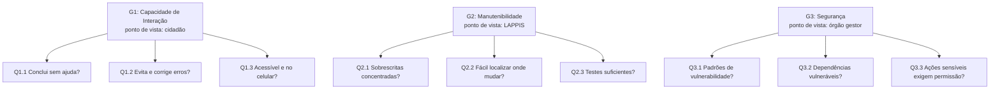

# Fase 2: Especificação da Avaliação (GQM)

Esta fase desdobra as três características priorizadas na [Fase 1](1.md) em objetivos de medição, questões e hipóteses, seguindo o método Goal-Question-Metric (GQM). Cada objetivo parte de uma decisão listada no Propósito da Avaliação (Fase 1, Seção 2) e adota o ponto de vista de uma das Partes Interessadas (Fase 1, Seção 3).

---

## 1. Referencial Teórico

**Responsável técnico**: José Vinícius Alvares Soares de Queiroz

A avaliação combina três referências. A família SQuaRE define o que é qualidade de produto e como conduzir a avaliação. O GQM liga essa qualidade a medidas concretas. O PSM e a ISO/IEC 15939 orientam a medição da gestão do próprio projeto.

### 1.1 Família SQuaRE (ISO/IEC 25000)

A série ISO/IEC 25000, chamada SQuaRE (*Systems and software Quality Requirements and Evaluation*), reúne as normas de requisitos e avaliação de qualidade de software. Ela se organiza em cinco divisões: gestão da qualidade (2500n), modelo de qualidade (2501n), medição (2502n), requisitos (2503n) e avaliação (2504n).

**Modelo de qualidade de produto (ISO/IEC 25010:2023).** A revisão de 2023 organiza a qualidade do produto em nove características. Nela, a antiga Usabilidade passou a se chamar **Capacidade de Interação** (*Interaction Capability*). Este trabalho usa três características e as subcaracterísticas abaixo:

| Característica | Subcaracterísticas usadas | Objetivo GQM |
| :--- | :--- | :---: |
| Capacidade de Interação | Apreensibilidade, operabilidade, proteção contra erros do usuário, inclusividade | G1 |
| Manutenibilidade | Modularidade, analisabilidade, testabilidade | G2 |
| Segurança | Confidencialidade, integridade, autenticidade, resistência | G3 |

**Processo de avaliação (ISO/IEC 25040).** A norma divide a avaliação em etapas: estabelecer os requisitos, especificar, projetar, executar e concluir. As fases da disciplina seguem essa ordem. A Fase 1 estabelece os requisitos, a Fase 2 especifica a medição, a Fase 3 projeta o plano de avaliação e a Fase 4 executa e conclui.

### 1.2 Goal-Question-Metric (GQM)

O GQM, proposto por Basili, Caldiera e Rombach, parte dos objetivos e desce até as métricas, para que nada seja medido sem motivo. O método tem três níveis:

1. **Conceitual (Objetivo)**: o que se avalia, para quê e do ponto de vista de quem. Segue o template *analisar* o objeto, *com o propósito de* uma finalidade, *em relação a* um foco de qualidade, *do ponto de vista de* uma parte interessada, *no contexto de* um ambiente.
2. **Operacional (Questão)**: perguntas que caracterizam o foco de qualidade e indicam quando o objetivo foi atingido.
3. **Quantitativo (Métrica)**: dados que respondem a cada questão de forma objetiva.

A equipe acrescenta uma **hipótese** por questão, registrando o resultado esperado antes da coleta. Na Fase 4, a hipótese serve de referência para interpretar os dados.

### 1.3 PSM e ISO/IEC 15939

A ISO/IEC/IEEE 15939 descreve o processo de medição de software: planejar, coletar, analisar e usar as medidas para decidir. O PSM (*Practical Software and Systems Measurement*) é o guia prático que deu origem à norma e agrupa as medidas em categorias de informação. A equipe acompanha o próprio projeto com três delas: Desempenho dos Processos, Calendário e Progresso, e Recursos e Custos.

---

## 2. Objetivos de Medição

**Responsável técnico**: José Vinícius Alvares Soares de Queiroz

São três objetivos, um por característica priorizada. O ponto de vista de cada um é a parte interessada que sofre primeiro quando aquela qualidade falha.

### G1: Capacidade de Interação

> **Analisar** o fluxo de participação do Brasil Participativo (entrada com a conta Gov.br, busca de um processo participativo, envio de proposta e apoio a propostas)
> **com o propósito de** identificar barreiras que levam à desistência
> **em relação à** capacidade de interação (apreensibilidade, operabilidade, proteção contra erros do usuário e inclusividade)
> **do ponto de vista do** cidadão / usuário final
> **no contexto de** pessoas sem uso prévio da plataforma, acessando pelo navegador no computador e no celular.

### G2: troque o texto do objetivo por este:

> **Analisar** o código-fonte do repositório decidim-govbr, em especial as classes que sobrescrevem o núcleo do Decidim (app/permissions/, app/commands/ e afins)
> **com o propósito de caracterizar** o esforço de manutenção e apontar os pontos que mais precisam de refatoração
> **em relação à** manutenibilidade (modularidade, analisabilidade e testabilidade)
> **do ponto de vista da** equipe de engenharia do LAPPIS
> **no contexto de** análise estática do repositório.

### G3: Segurança

> **Analisar** código-fonte do repositório decidim-govbr  e as dependências declaradas no seu Gemfile.lock
> **com o propósito de** avaliar a proteção dos dados e das ações dos participantes
> **em relação à** segurança (confidencialidade, integridade, autenticidade e resistência)
> **do ponto de vista do** órgão gestor governamental (Secretaria de Participação / MGI)
> **no contexto de** análise estática e verificação de dependências, sem nenhum teste ativo contra a instância de produção.

### 2.1 Rastreabilidade com a Fase 1

| Objetivo | Característica priorizada | Decisão apoiada (Fase 1, Seção 2.2) | Ponto de vista (Fase 1, Seção 3) |
| :---: | :--- | :--- | :--- |
| G1 | Capacidade de Interação | 3. Redesenho de fluxos de interação cidadã | Cidadão / usuário final |
| G2 | Manutenibilidade | 1. Priorização de refatoração no código Ruby on Rails | Equipe de engenharia / LAPPIS |
| G3 | Segurança | 2. Endurecimento de autenticação e autorização | Órgão gestor governamental |

O objetivo G1 adota o ponto de vista do cidadão porque é ele quem desiste do formulário, embora quem decide o redesenho seja a Secretaria de Participação Digital. A requisitante acadêmica não aparece como ponto de vista: ela avalia o rigor do processo, não usa o produto.

---

## 3. Questões 

**Responsável técnico**: José Vinícius Alvares Soares de Queiroz

Cada objetivo tem três questões, e cada questão cobre uma subcaracterística.

| ID | Questão | Subcaracterística |
| :---: | :--- | :--- |
| Q1.1 | Um cidadão que nunca usou a plataforma consegue concluir as tarefas centrais de participação sem ajuda? | Apreensibilidade e operabilidade |
| Q1.2 | A plataforma evita erros no login e no envio de propostas e ajuda o cidadão a corrigi-los quando acontecem? | Proteção contra erros do usuário |
| Q1.3 | O fluxo de participação pode ser usado por pessoas com deficiência e por quem acessa pelo celular? | Inclusividade |
| Q2.1 | As customizações que sobrescrevem classes do Decidim estão concentradas em poucos lugares, de forma que atualizar o Decidim não exija revisar muitos arquivos? | Modularidade |
| Q2.2 | Um desenvolvedor novo consegue entender o código do decidim-govbr e localizar onde fazer uma mudança com pouco esforço? | Analisabilidade |
| Q2.3 | As classes customizadas do decidim-govbr têm testes automatizados (RSpec) que verificam uma mudança com segurança? | Testabilidade |
| Q3.1 | O código do decidim-govbr contém padrões conhecidos de vulnerabilidade que possam expor ou alterar dados dos participantes? | Confidencialidade e integridade |
| Q3.2 | As dependências declaradas no `Gemfile.lock` estão livres de vulnerabilidades conhecidas e atualizadas? | Resistência |
| Q3.3 | As ações sensíveis (administração, moderação, alteração de propostas) só podem ser feitas por usuários autenticados e com permissão? | Autenticidade |

As questões Q1.x serão respondidas com sessões de teste com usuários (com TCLE) e verificação de acessibilidade. As questões Q2.x e Q3.x serão respondidas por análise estática do repositório, conforme a restrição de ambiente da equipe.

---

## 4. Hipóteses 

**Responsável técnico**: José Vinícius Alvares Soares de Queiroz

Cada questão tem uma hipótese verificável e o motivo de se esperar aquele resultado. Os limites numéricos são valores de referência e serão calibrados junto com os níveis de pontuação. Nenhum deles é dado coletado.

| ID | Hipótese | Motivo |
| :---: | :--- | :--- |
| H1.1 | Pelo menos 80% dos participantes concluem as tarefas centrais sem ajuda; o envio de proposta terá a menor taxa de conclusão | O envio de proposta tem mais etapas e campos do que buscar ou apoiar |
| H1.2 | Erros de preenchimento são sinalizados, mas a mensagem nem sempre diz como corrigir, levando a pelo menos uma nova tentativa por sessão | O login passa pelo Gov.br, fora da plataforma, o que dificulta orientar o usuário quando algo falha |
| H1.3 | As páginas centrais não terão falhas graves de acessibilidade, mas haverá problemas de contraste ou de rótulos nos elementos visuais customizados | As páginas de `decidim-homes` e os ajustes de `decidim-mobile` foram feitos fora do núcleo do Decidim |
| H2.1 | Parte das customizações sobrescreve classes do núcleo do Decidim, em vez de ficar em engines separadas | No commit 176b046 há classes em app/permissions/decidim/ e app/commands/decidim/ com os mesmos caminhos do Decidim |
| H2.2 | 	A complexidade média dos métodos é baixa, mas se concentra em poucos arquivos do decidim-govbr | Em aplicações Rails, a lógica tende a se acumular em alguns controllers e serviços |
| H2.3 | Nem todas as classes sobrescritas têm teste correspondente em spec/ | O repositório tem 156 arquivos de teste em spec/, a maioria em spec/commands; a cobertura por classe ainda não foi medida |
| H3.1 | A análise estática encontra poucos ou nenhum achado de alta severidade no código das extensões | O Rails traz proteções contra CSRF e injeção de HTML, e há um relatório do Brakeman na raiz do repositório |
| H3.2 | Pelo menos uma dependência terá vulnerabilidade conhecida | O projeto fixa Rails 6.1.7 e Ruby 3.0.4, versões com correções de segurança publicadas depois |
| H3.3 | Todas as ações administrativas exigem autenticação e verificação de permissão | 	O decidim-govbr sobrescreve classes de permissão do Decidim em app/permissions/ e tem testes para elas em spec/permissions/ |

---

## 5. Hierarquia Parcial 
<!-- PENDENTE: acrescentar as métricas no último nível do diagrama e depois apagar este comentário. -->

<!--
PENDENTE (apagar este comentário quando concluir):
- Métricas: definição, fórmula, fonte, coleta e interpretação de cada uma.
- Níveis de pontuação e critérios de julgamento para todas as métricas.
- Diagrama GQM completo, com as métricas.
-->

## Histórico de Versões

| Versão | Data | Descrição | Autor | Revisor |
| :---: | :---: | :--- | :--- | :--- |
| `1.0` | 18/10/2026 | Referencial teórico, objetivos GQM, questões, hipóteses e hierarquia parcial | [José Vinícius Alvares Soares de Queiroz](https://github.com/JoseViniciusQueiroz) | [João Victor da Silva Batista de Farias](https://github.com/beyondmagic) |
