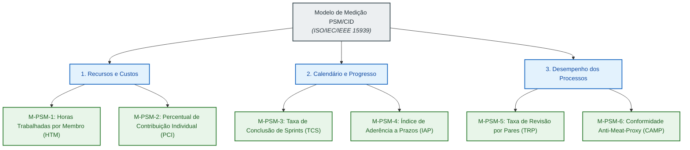

# Gestão do Projeto com Métricas PSM/CID

Esta página documenta o acompanhamento da execução e governança da equipe **Frans Bilas (Turma 01)** na disciplina **Qualidade de Software 1 (FGA0315 - 2026.2)**. Enquanto o método GQM é empregado na avaliação da qualidade do produto de software (Brasil Participativo), a gestão interna do projeto apoia-se no framework **PSM (*Practical Software Measurement*)** e na norma internacional **ISO/IEC/IEEE 15939:2017**.

---

## 1. Estrutura do Modelo de Medição PSM

Conforme preconizado pelo PSM e exigido na Seção 2 da especificação do trabalho final, a equipe acompanha o projeto em três categorias de informação:

1. **Recursos e Custos (*Resources & Cost*)**: distribuição de esforço, horas trabalhadas e transparência na divisão do trabalho.
2. **Calendário e Progresso (*Schedule & Progress*)**: cumprimento dos marcos, taxa de conclusão de sprints e aderência a prazos.
3. **Desempenho dos Processos (*Process Performance*)**: eficácia do fluxo de trabalho, revisões cruzadas e garantia de escrita humana contra vícios de IA.

---

## 2. Categoria 1: Recursos e Custos

Esta categoria monitora a alocação de tempo e a paridade de esforço entre todos os integrantes da equipe.

### 2.1 M-PSM-1: Horas Trabalhadas por Membro (HTM)

- **Conceito Mensurável**: Quantidade de horas dedicadas semanalmente por cada membro em cerimônias de sprint, pesquisa normativa, redação técnica, implementação de scripts e revisões de código.
- **Procedimento de Cálculo**:

    $$
    HTM_i = \sum_{k=1}^{T_i} t_{i,k}
    $$

    onde $t_{i,k}$ é o tempo em horas despendido pelo integrante $i$ na atividade $k$, e $T_i$ é o número total de tarefas realizadas na semana.

- **Fonte e Procedimento de Coleta**: Apontamento individual consolidado pela Dupla 3 ao término de cada sprint. A equipe realiza check-ins curtos após as aulas presenciais de segunda e quarta-feira, registrando as horas nas atas de sprint.
- **Meta e Critério de Controle**: Linha de base estipulada em **6 a 8 horas/semana por membro**. Valores abaixo de 4 horas geram alerta de sobrecarga para os demais colegas; valores acima de 12 horas exigem rebalanceamento de atividades.

### 2.2 M-PSM-2: Percentual de Contribuição Individual (PCI)

- **Conceito Mensurável**: Proporção de esforço de cada integrante na execução global do projeto acadêmico, atendendo à premissa 13 e ao critério AG-C5 da disciplina.
- **Procedimento de Cálculo**:

    $$
    PCI_i = \left( \frac{HTM_i}{\sum_{j=1}^{N} HTM_j} \right) \times 100\% = \frac{1}{6} \times 100\% \approx 16{,}67\%
    $$

- **Fonte e Procedimento de Coleta**: Matriz de responsabilidades pactuada no início do projeto e confirmada pela entrega balanceada de artefatos por cada uma das três duplas de trabalho.
- **Critério de Julgamento**: Divisão paritária com total acumulado somando exatamente **100%**.

### 2.3 Tabela Oficial de Contribuição da Equipe (Critério AG-C5)

A tabela abaixo detalha as atribuições individuais e o esforço paritário estabelecido para a Entrega 1:

| Integrante | Papel no Projeto | Principais Responsabilidades e Entregáveis | Horas Est. (Sprint 1) | Esforço (%) |
| :--- | :--- | :--- | :---: | :---: |
| **João Victor da Silva Batista de Farias** | Dupla 1 (Qualidade/GQM) | Propósito da avaliação, mapeamento de stakeholders, contextualização técnica e caracterização da arquitetura. | ~7h | **16,67%** |
| **Mateus Vinícius Vieira** | Dupla 1 (Qualidade/GQM) | Modelo de qualidade SQuaRE, priorização preliminar, escopo, profundidade e alinhamento aos ODS. | ~7h | **16,67%** |
| **José Vinícius Alvares Soares de Queiroz** | Dupla 2 (GQM/Métricas) | Referencial teórico (SQuaRE/GQM/PSM), objetivos GQM, questões, hipóteses e implicações de medição. | ~7h | **16,67%** |
| **Lucca Medeiros Silva** | Dupla 1 e 2 (Métricas) | Fichas técnicas das 12 métricas, formulação matemática MathJax, níveis de pontuação e matriz de rastreabilidade. | ~7h | **16,67%** |
| **Miguel Arthur Oliveira de Lima** | Dupla 3 (Gestão/Infra) | Diagrama SQuaRE em Mermaid, matriz formal de priorização, governança, métricas PSM/CID e consolidação. | ~7h | **16,67%** |
| **Davi Mesquita Sousa** | Dupla 3 (Gestão/Infra) | Revisão textual e de estilo, alinhamento dos slides da Entrega 1 e suporte à infraestrutura da GitPage. | ~7h | **16,67%** |
| **TOTAL** | — | **Esforço Coletivo Consolidado** | **~42h** | **100,00%** |

---

## 3. Categoria 2: Calendário e Progresso

Esta categoria acompanha a cadência de entrega dos sprints e a aderência aos marcos cronológicos da disciplina.

### 3.1 M-PSM-3: Taxa de Conclusão de Sprints (TCS)

- **Conceito Mensurável**: Grau de entrega dos itens planejados no backlog do sprint em relação ao total comprometido no início do ciclo.
- **Procedimento de Cálculo**:

    $$
    TCS = \left( \frac{N_{\text{entregues}}}{N_{\text{planejados}}} \right) \times 100
    $$

    onde $N_{\text{entregues}}$ são os artefatos mergeados na branch `main` e $N_{\text{planejados}}$ são as atividades descritas no Plano de Sprints.

- **Fonte e Procedimento de Coleta**: Auditoria das branches e merges integrados à branch principal do repositório ao final de cada ciclo.
- **Meta e Resultado Atual**: Meta de $TCS \ge 90\%$. No **Sprint 1 (14/10 a 19/10)**, 100% dos tópicos da Fase 1, slides e apresentação do PC1 foram concluídos com sucesso.

### 3.2 M-PSM-4: Índice de Aderência a Prazos (IAP)

- **Conceito Mensurável**: Pontualidade das entregas acadêmicas, mensurada pelo desvio temporal entre a data da release e a data limite.
- **Procedimento de Cálculo**:

    $$
    IAP = Data_{\text{efetiva}} - Data_{\text{planejada}} \quad \text{(em dias)}
    $$

- **Fonte e Procedimento de Coleta**: Carimbos de data/hora das tags de release no Git confrontados com o cronograma da disciplina.
- **Interpretação**:
  - $IAP \le 0$: Entrega pontual ou antecipada (estratégia da equipe de cortar a release 24 horas antes do prazo limite).
  - $IAP > 0$: Atraso na entrega (impacta a penalidade prevista de perda de 50% da nota por dia de atraso).

---

## 4. Categoria 3: Desempenho dos Processos

Esta categoria avalia o rigor metodológico e a qualidade do fluxo colaborativo de desenvolvimento.

### 4.1 M-PSM-5: Taxa de Revisão por Pares (TRP)

- **Conceito Mensurável**: Percentual de contribuições submetidas via Pull Request que contaram com revisão formal por membro de outra dupla antes do merge definitivo.
- **Procedimento de Cálculo**:

    $$
    TRP = \left( \frac{PR_{\text{revisados}}}{PR_{\text{total}}} \right) \times 100
    $$

- **Fonte e Procedimento de Coleta**: Histórico de Pull Requests no repositório GitHub (`PR #1`, `PR #2`, `PR #3`), inspecionando os registros de aprovação.
- **Meta e Controle**: Meta de **100%**. Nenhum código ou documentação deve ser integrado sem validação de um segundo par de olhos.

### 4.2 M-PSM-6: Conformidade com Diretrizes Anti-Meat-Proxy (CAMP)

- **Conceito Mensurável**: Índice de aderência às diretrizes de escrita humana, terminologia SQuaRE (ISO/IEC 25010:2023) e ausência de jargões artificiais de IA nos textos técnicos.
- **Procedimento de Cálculo**:

    $$
    CAMP = \left( \frac{A_{\text{validados}}}{A_{\text{auditados}}} \right) \times 100
    $$

    onde $A$ representa os arquivos Markdown e LaTeX inspecionados.

- **Fonte e Procedimento de Coleta**: Execução automatizada do script `scripts/check_humanizer.py` integrado ao hook de pré-commit e ao workflow do GitHub Actions (`.github/workflows/humanizer-check.yml`).
- **Meta e Resultado Atual**: Meta de **100%**. Todos os 11 arquivos de documentação auditados no repositório foram aprovados com zero violações.

---

## 5. Acompanhamento dos Sprints da Equipe

| Sprint | Período | Foco Temático e Entregáveis | Status | TCS (%) | IAP |
| :---: | :---: | :--- | :---: | :---: | :---: |
| **Sprint 1** | 14/10 a 19/10 | Fase 1 completa, estruturação da GitPage, slides e apresentação do PC1. | **Concluído** | 100% | 0 dia |
| **Sprint 2** | 20/10 a 25/10 | Fase 2 (GQM), Gestão PSM/CID, artigo científico v1 e Release E1. | **Em andamento** | — | — |
| **Sprint 3** | 27/10 a 04/11 | Fase 3: Plano de Avaliação, recursos de teste e Ponto de Controle 2. | Planejado | — | — |
| **Sprint 4** | 05/11 a 11/11 | Execução da coleta, consolidação de dados brutos e primeira melhoria técnica. | Planejado | — | — |
| **Sprint 5** | 12/11 a 17/11 | Fase 4: Julgamento, segunda melhoria técnica, artigo v2 e Release E2. | Planejado | — | — |
| **Sprint 6** | 19/11 a 30/11 | Preparação para a apresentação final e encerramento do projeto. | Planejado | — | — |

---

## Histórico de Versões

| Versão | Data | Descrição | Autor | Revisor |
| :---: | :---: | :--- | :--- | :--- |
| `1.0` | 21/10/2026 | Estruturação formal do modelo PSM/CID, métricas de processo e Tabela de Contribuição paritária (100%) | [Miguel Arthur Oliveira de Lima](https://github.com/zlimaz) | A definir |
