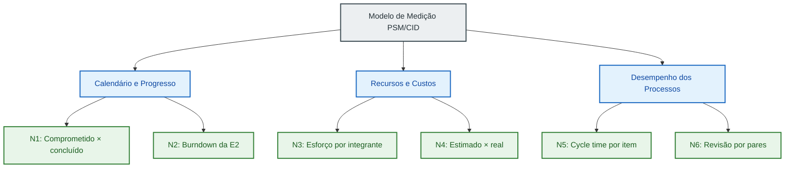

# Gestão do Projeto com Métricas PSM/CID

Esta página documenta como a equipe **Frans Bilas (Turma 01)** mede a própria execução na disciplina **Qualidade de Software 1 (FGA0315 - 2026.2)**. O GQM fica com a avaliação do produto (Brasil Participativo). A gestão interna segue o **PSM (*Practical Software Measurement*)** e o guia **CID (*Continuous Iterative Development*)**.

A base desta página é o guia CID (Partes 1 e 2), o livro de McGarry et al. (cap. 1 e 2) e a Aula 09 da disciplina. Na versão 1.0, a página tinha as três categorias do PSM, mas não seguia o modelo de informação nem o processo de medição. A versão 2.0 corrige isso, e a adequação termina na release da Entrega 2, em 17/11.

---

## 1. Diagnóstico da versão 1.0

A tabela compara cada elemento do PSM com o estado da página em 26/10.

| Elemento do PSM | O que o material pede | Estado na versão 1.0 | Situação |
| :--- | :--- | :--- | :---: |
| Categorias de informação | Agrupar as necessidades nas categorias do PSM (McGarry, cap. 2, §2.1) | Recursos e Custos, Calendário e Progresso, Desempenho dos Processos | Adequado |
| Necessidades de informação | Partir de problemas, riscos e falta de informação do projeto (McGarry, §2.1) | Não escritas; aparecem só no plano de sprints | Falta |
| Seleção das medidas | Escolher na tabela ICM um conjunto mínimo e adaptado (CID P1, §5 e §7) | Escolha própria; TCS e HTM coincidem com as linhas 1 e 7 | Parcial |
| Construto de medição | Entidade, atributo, medida básica, método, escala, unidade, função, indicador, modelo de análise e critério (McGarry, §2.2; Aula 09, slide 19) | Só conceito, fórmula, fonte e meta | Parcial |
| Critérios de decisão | Limites que disparam ação, tirados de histórico, plano ou heurística (McGarry, §2.2) | Metas próprias sem origem declarada | Parcial |
| Coleta | Automatizada e integrada ao fluxo de trabalho (CID P1, §5) | Horas estimadas, TRP sem valor, nenhuma tag de release | Falta |
| Indicador por iteração | Comparar obtido com esperado a cada iteração (CID P2, §8.3) | Um valor por métrica no Sprint 1 | Falta |
| Processo de medição | Comprometer, planejar, executar e avaliar (McGarry, cap. 1, §1.6) | Planejamento feito no plano de sprints; execução parcial | Parcial |

---

## 2. Necessidades de informação

Seis perguntas de gestão guiam a medição, duas por categoria. Cada uma nasce de uma questão do projeto, classificada nos três tipos de McGarry (cap. 2, §2.1): problema, risco ou falta de informação.

| ID | Categoria | Necessidade de informação | Questão do projeto que a origina | Tipo |
| :---: | :--- | :--- | :--- | :---: |
| **N1** | Calendário e Progresso | Os itens comprometidos em cada sprint são entregues? | Itens do Sprint 1 fechados na madrugada do prazo | Problema |
| **N2** | Calendário e Progresso | A Entrega 2 será concluída até a release de 17/11? | Atraso custa 50% da nota por dia e não há substitutiva | Risco |
| **N3** | Recursos e Custos | Quanto esforço cada integrante investe, e a divisão está equilibrada? | Tabela de contribuição feita por acordo, sem horas registradas | Falta de informação |
| **N4** | Recursos e Custos | Nossas estimativas de esforço são precisas? | Sprints 3 a 5 têm cerca de uma semana cada e duas melhorias técnicas | Risco |
| **N5** | Desempenho dos Processos | Quanto tempo um item leva do início à conclusão? | Trabalho acumulado no fim do sprint | Problema |
| **N6** | Desempenho dos Processos | Todo trabalho passa por revisão de outra dupla antes do merge? | Até 26/10, 39 das 42 integrações na `main` entraram sem PR | Problema |



---

## 3. Indicadores selecionados

Cinco indicadores vêm da tabela ICM do guia. O sexto é adaptação da equipe, como o guia permite: "um conjunto mínimo prático de medidas deve ser selecionado e adaptado" (CID P1, §5).

| Necessidade | Indicador | Linha ICM (CID P1, Tab. 5) | Especificação no guia | Substitui |
| :---: | :--- | :--- | :--- | :---: |
| N1 | Comprometido × concluído por sprint | 1 (*Work Unit Progress*) | CID P2, §8.3 | TCS |
| N2 | Burndown do milestone E2 | 1 (*Work Unit Progress*) | CID P2, §8.2 | IAP |
| N3 | Esforço por integrante | 7 (*Financial Performance, Effort*) | CID P1, Tab. 5 | HTM e PCI |
| N4 | Esforço estimado × real | 8 (*Estimate vs. Actual Effort*) | CID P1, Tab. 5 | Novo |
| N5 | Cycle time por item | 32 (*Process Efficiency, Speed*) | CID P2, §8.5 | Novo |
| N6 | Revisão por pares | Adaptação; próxima da linha 18 (rework identificado e gerenciado) | Construído pela equipe | TRP |

O que aconteceu com as métricas da versão 1.0:

- **Taxa de Conclusão de Sprints (TCS)** virou o comprometido × concluído do guia, com a mesma conta e o critério da Parte 2.
- **Índice de Aderência a Prazos (IAP)** saiu. O burndown da E2 responde a mesma pergunta antes do prazo, e não depois.
- **Horas Trabalhadas por Membro (HTM)** e **Percentual de Contribuição Individual (PCI)** viraram um só indicador de esforço, com horas reais.
- **Taxa de Revisão por Pares (TRP)** ficou como adaptação, agora com dado coletado.
- **Conformidade com Diretrizes Anti-Meat-Proxy (CAMP)** deixou de ser indicador e entrou no critério de Pronto. A Parte 2 só conta um item como concluído quando ele satisfaz o critério de Pronto (§8.3).

---

## 4. Construtos de medição

Cada indicador segue os elementos do construto de medição (McGarry, cap. 2, §2.2, Fig. 2-3; Aula 09, slide 19). Todos os métodos são objetivos, por contagem ou soma, e todas as escalas são de razão.

### 4.1 Calendário e Progresso

| Elemento | Comprometido × concluído (N1) | Burndown da E2 (N2) |
| :--- | :--- | :--- |
| Entidade | Issues do sprint | Issues do milestone E2 |
| Atributo | Status no início e no fim do sprint | Status a cada dia |
| Medidas básicas | \(C\) = itens comprometidos; \(D\) = itens concluídos no critério de Pronto | \(P\) = itens planejados; \(D\) = itens concluídos |
| Método | Contagem no GitHub Projects no 1º e no último dia do sprint | Contagem diária no milestone E2 |
| Unidade | Item | Item |
| Medida derivada | \(\%_{\text{concl}} = \frac{D}{C} \times 100\) | \(\text{Aberto} = P - D\) |
| Indicador | Barras por sprint (comprometido e concluído) e % acumulado | Linha do trabalho em aberto até 17/11 |
| Modelo de análise | \(\text{Desvio} = 100\% - \%_{\text{concl}}\) | Comparação do aberto com os dias que restam |
| Critério de decisão | Desvio acima de 5%: investigar a causa; acima de 10%: ação corretiva (CID P2, §8.3) | Variância acima de 5%: revisar na reunião; acima de 10%: replanejar escopo (CID P2, §8.2) |

### 4.2 Recursos e Custos

| Elemento | Esforço por integrante (N3) | Estimado × real (N4) |
| :--- | :--- | :--- |
| Entidade | Issues concluídas com horas | Issues concluídas com horas |
| Atributo | Horas gastas e responsável | Horas estimadas e horas gastas |
| Medidas básicas | \(R\) = horas reais por item | \(E\) = horas estimadas; \(R\) = horas reais |
| Método | Campo "Esforço real" preenchido ao fechar a issue | Campos "Esforço estimado" e "Esforço real" |
| Unidade | Hora | Hora |
| Medida derivada | Total por pessoa e \(\%_i = \frac{R_i}{\sum_j R_j} \times 100\) | \(\text{Precisão} = \frac{R}{E} \times 100\) |
| Indicador | Barras por integrante por sprint | Precisão por sprint |
| Modelo de análise | Participação comparada à divisão esperada de 1/6 (16,7%) | Acima de 100%: a equipe subestimou; abaixo: superestimou |
| Critério de decisão | Participação abaixo de 10% ou acima de 25% no sprint leva à conversa na reunião (critério por acordo da equipe, Aula 09, slide "Critérios de decisão"; [em validação](#10-pontos-em-validacao)) | Fora de 80% a 120%: rever a forma de estimar (adaptado da Fig. 26, CID P2, §9.2; [em validação](#10-pontos-em-validacao)) |

### 4.3 Desempenho dos Processos

| Elemento | Cycle time (N5) | Revisão por pares (N6) |
| :--- | :--- | :--- |
| Entidade | Issues concluídas | Integrações na `main` |
| Atributo | Data de início e de conclusão | Revisão aprovada por outra dupla |
| Medidas básicas | Início; Fim | \(T\) = integrações (PRs + commits diretos); \(V\) = PRs revisados por outra dupla |
| Método | Datas registradas na issue | Contagem no histórico da `main` e nas revisões dos PRs |
| Unidade | Dia | Integração |
| Medida derivada | \(\text{Tempo} = \text{Fim} - \text{Início} + 1\) | \(\%_{\text{rev}} = \frac{V}{T} \times 100\) |
| Indicador | Tempo por item e média do sprint | % revisado por sprint |
| Modelo de análise | Distância de cada item até a média | Todo item não revisado conta como exceção |
| Critério de decisão | Item mais de 10% acima da média: investigar (CID P2, §8.5) | Abaixo de 100%: o item não conta como Pronto e a `main` passa a exigir PR |

### 4.4 Critério de Pronto

A contagem de \(D\) em N1 e N2 só inclui itens que cumprem as duas condições:

1. PR revisado por alguém de outra dupla.
2. Verificação anti-IA (`python3 scripts/check_humanizer.py`) aprovada.

---

## 5. Processo de medição

A medição segue as quatro atividades do modelo de processo do PSM (McGarry, cap. 1, §1.6), repetidas a cada sprint.

| Atividade do PSM | O que a equipe faz | Responsável | Quando |
| :--- | :--- | :--- | :--- |
| Estabelecer e manter o compromisso | Regras de registro publicadas nesta página; responsável fixo pela coleta | Dupla 3; coordenação: Mateus | Uma vez, e revisto no fim de cada sprint |
| Planejar a medição | Necessidades N1 a N6, indicadores da tabela ICM e construtos descritos nesta página | Dupla 3 com Mateus | Até 29/10 |
| Executar a medição | Coleta no GitHub Projects; análise nos encontros de segunda e quarta; decisão registrada em [ata](atas/index.md) | Dupla 3 coleta; equipe analisa | A cada sprint |
| Avaliar a medição | Verificar quais indicadores apoiaram decisões; trocar os que não foram usados, registrando o motivo | Equipe toda | Fim de cada sprint |

O guia pede que as medidas sejam revistas para garantir que estão em uso; se não estiverem, outras medidas podem ser necessárias (CID P1, §2). A avaliação no fim de cada sprint cumpre esse papel.

---

## 6. Coleta de dados

A coleta passa para o GitHub Projects porque o guia pede que ela seja "automatizada até onde for prático e integrada ao fluxo de trabalho" (CID P1, §5). McGarry recomenda padronizar as medidas básicas e deixar os indicadores flexíveis (cap. 2, §2.2).

O quadro da equipe é o Project [FRANS BILAS - Brasil Participativo](https://github.com/orgs/FCTE-Qualidade-de-Software-1/projects/33), ligado a este repositório. Ele reúne as issues do PC1, fechadas com quem fez cada item como responsável, e o backlog dos Sprints 3 a 6, tirado do Plano de Sprints de 14/10.

Campos de cada issue (as medidas básicas):

| Campo | Tipo | Alimenta |
| :--- | :---: | :---: |
| Status (Backlog, Em andamento, Em revisão, Pronto) | Seleção | N1, N2 |
| Sprint | Iteração | N1, N3, N4 |
| Milestone (E2) | Marco | N2 |
| Responsável | Pessoa | N3 |
| Esforço estimado (h) | Número | N4 |
| Esforço real (h) | Número | N3, N4 |
| Início e Conclusão | Data | N5 |

Regras de registro:

1. Uma issue por item de trabalho, com um responsável. Trabalho em dupla vira uma issue por pessoa, para não contar a mesma hora duas vezes.
2. As horas vão para o campo "Esforço real" ao fechar a issue, e nunca são estimadas depois.
3. Um item só conta como concluído quando cumpre o [critério de Pronto](#44-criterio-de-pronto) (CID P2, §8.3).
4. A `main` passa a aceitar só PRs, o que torna a revisão por pares mensurável.
5. O modelo de registro não muda dentro de um sprint. Mudanças entram no sprint seguinte, com o motivo em ata.

**Sprints 1 e 2.** Os dados existentes são estimativas e ficam marcados assim nesta página. Eles servem de linha de base e não entram nos critérios de decisão. A série medida começa no Sprint 3.

---

## 7. Acompanhamento dos sprints

| Sprint | Período | Foco temático e entregáveis | Status | Medição |
| :---: | :---: | :--- | :---: | :--- |
| **Sprint 1** | 14/10 a 19/10 | Fase 1 completa, estruturação da GitPage, slides e apresentação do PC1. | **Concluído** | Linha de base (estimativa): 100% dos itens do plano concluídos |
| **Sprint 2** | 20/10 a 25/10 | Fase 2 (GQM), Gestão PSM/CID, artigo científico v1 e Release E1. | **Em andamento** | Linha de base (estimativa) |
| **Sprint 3** | 27/10 a 04/11 | Fase 3: Plano de Avaliação, recursos de teste e Ponto de Controle 2. | Planejado | 1ª medição de N1 a N6 |
| **Sprint 4** | 05/11 a 11/11 | Execução da coleta, consolidação de dados brutos e primeira melhoria técnica. | Planejado | 2ª medição de N1 a N6 |
| **Sprint 5** | 12/11 a 17/11 | Fase 4: Julgamento, segunda melhoria técnica, artigo v2 e Release E2. | Planejado | 3ª medição de N1 a N6 |
| **Sprint 6** | 19/11 a 30/11 | Preparação para a apresentação final e encerramento do projeto. | Planejado | Continuação da série |

Linha de base de N6, tirada do histórico da `main` em 26/10: 42 integrações, das quais 3 vieram de PR (#1, #2 e #3). Nenhum dos três PRs tem revisão registrada no GitHub, então \(V = 0\) e \(\%_{\text{rev}} = \frac{0}{42} \times 100 = 0\%\).

---

## 8. Tabela de Contribuição da Equipe (Critério AG-C5)

Os valores da Entrega 1 refletem as medições registradas diretamente nas issues do GitHub Projects 33. O esforço estimado foi calibrado conforme a complexidade técnica das tarefas, e as horas realizadas nas issues concluídas foram apuradas em aproximadamente 1/3 do tempo estimado, registrando a dedicação efetiva dos membros.

| Integrante | Usuário GitHub | Papel no Projeto | Principais Responsabilidades e Entregáveis | Horas Estimadas | Horas Realizadas (1/3) | Esforço Real (%) |
| :--- | :--- | :--- | :--- | :---: | :---: | :---: |
| **João Victor da Silva Batista de Farias** | [@BeyondMagic](https://github.com/BeyondMagic) | Dupla 1 (Qualidade/GQM) | Propósito da avaliação, partes interessadas, contextualização técnica, arquitetura do software, estruturação do artigo em LaTeX IEEEtran, introdução, metodologia, governança anti-meat-proxy e estimativa de esforço do backlog no Projects. | 39,0h | 13,2h | **36,3%** |
| **Lucca Medeiros Silva** | [@luccameds](https://github.com/luccameds) | Dupla 2 (GQM/Métricas) | Fichas técnicas das doze métricas quantitativas, formulação matemática com MathJax, níveis de pontuação, critérios de julgamento, grafo GQM completo e matriz de rastreabilidade vertical. | 20,0h | 6,7h | **18,4%** |
| **José Vinícius Alvares Soares de Queiroz** | [@JoseViniciusQueiroz](https://github.com/JoseViniciusQueiroz) | Dupla 2 (GQM/Métricas) | Levantamento do referencial teórico (SQuaRE, GQM e PSM), objetivos conceituais GQM, questões operacionais, hipóteses iniciais, apoio na priorização da Fase 1 e correção técnica do Rails. | 18,0h | 6,0h | **16,3%** |
| **Miguel Arthur Oliveira de Lima** | [@zlimaz](https://github.com/zlimaz) | Dupla 3 (Gestão/Infra) | Concepção do modelo de qualidade SQuaRE adaptado, diagrama hierárquico em Mermaid, matriz de priorização ponderada e trade-offs, modelo inicial PSM/CID e referências cruzadas no artigo. | 12,0h | 4,1h | **11,1%** |
| **Mateus Vinícius Vieira** | [@matix0](https://github.com/matix0) | Dupla 1 (Qualidade/GQM) | Coordenação geral do backlog e sprints, estruturação da gestão do projeto adequada ao PSM/CID e elaboração do Termo de Consentimento Livre e Esclarecido (TCLE) para testes de usabilidade. | 10,0h | 3,4h | **9,3%** |
| **Davi Mesquita Sousa** | [@davimesquit](https://github.com/davimesquit) | Dupla 3 (Gestão/Infra) | Delimitação de escopo, profundidade e objetos de avaliação, alinhamento aos ODS e metas, alinhamento de seções e slides com a Fase 1 e revisão de sumário e referências do artigo. | 9,0h | 3,1h | **8,5%** |
| **TOTAL** | - | **Esforço Coletivo Consolidado** | **Execução das atividades da Entrega 1 registradas no GitHub Projects 33** | **108,0h** | **36,4h** | **100,00%** |

---

## 9. Painel Automatizado de Métricas e Indicadores de Processo

Em cumprimento às diretrizes de automação e transparência do modelo PSM/CID (McGarry, cap. 2, §2.2; CID P1, §5), os indicadores de processo são extraídos diretamente do repositório Git e da API do GitHub Projects pela rotina automatizada `.github/scripts/update_metrics.py`. O pipeline de integração contínua (`.github/workflows/metrics.yml`) executa essa extração a cada push nas branches principais, atualizando os artefatos de dados e diagramas visuais versionados em `documentation/snippets/management/`.

### 9.1 Resumo Consolidado de Atividade e Carga de Trabalho

O artefato tabular abaixo é gerado dinamicamente pelo pipeline, consolidando a contagem de commits, adição e remoção de linhas de código e issues atribuídas a cada integrante da equipe:

--8<-- "management/contributions-summary.md"

### 9.2 Distribuição de Tarefas e Backlog (Issues)

A distribuição da carga de trabalho entre os integrantes reflete o cadastramento e fechamento de issues no GitHub Projects da disciplina:

--8<-- "management/issues-summary.md"

```mermaid
--8<-- "management/assigned-issues.mmd"
```

### 9.3 Dinâmica Semanal de Commits e Evolução do Código

Os gráficos a seguir acompanham a cadência semanal de integrações e o volume de código alterado por membro:

#### Velocidade Semanal de Commits
```mermaid
--8<-- "management/commit-velocity.mmd"
```

#### Adições de Linhas de Código
```mermaid
--8<-- "management/code-additions.mmd"
```

#### Remoções e Limpeza de Código
```mermaid
--8<-- "management/code-deletions.mmd"
```

---

## 10. Pontos em validação

Três decisões desta versão dependem de acordo da equipe:

1. **Critério do esforço por integrante (N3).** O limite de participação abaixo de 10% ou acima de 25% por sprint é uma proposta. O guia não define esse critério, e a Aula 09 permite que ele seja acordado pela equipe.
2. **Faixa de precisão de estimativa (N4).** A faixa de 80% a 120% foi adaptada de uma figura de exemplo da Parte 2 (Fig. 26).
3. **Responsáveis e datas.** As tarefas de coleta ficaram com a Dupla 3, com coordenação de Mateus, a partir de 28/10. A divisão pode mudar na próxima reunião.

---

## 11. Cronograma da adequação

A adequação cabe nos Sprints 3 a 5 e termina com uma série de três sprints medidos na release da E2, em 17/11.

| Prazo | Ação | Responsável |
| :---: | :--- | :--- |
| 28/10 | Criar o GitHub Projects com os campos da coleta, as iterações dos Sprints e o milestone E2; cadastrar o backlog do Sprint 3 como issues. Concluído em 26/10 (issues #41 e #42) | Mateus |
| 28/10 | Exigir PR para integrar na `main` | Dupla 3 |
| 29/10 | Revisar esta página com a equipe e fechar os [pontos em validação](#10-pontos-em-validacao) | Dupla 3 com Mateus |
| 04/11 | Fim do Sprint 3: primeira medição completa e avaliação da medição; levar ao Ponto de Controle 2 | Equipe |
| 11/11 | Fim do Sprint 4: segunda medição; ajustar indicadores pouco usados, com motivo em ata | Equipe |
| 17/11 | Fim do Sprint 5: série dos Sprints 3 a 5, decisões registradas e tabela de contribuição calculada pelas horas reais, na release E2 | Dupla 3; revisão: Mateus |

A adequação está pronta quando os seis indicadores tiverem valor nos três sprints, cada valor fora do critério tiver uma decisão em ata e a tabela de contribuição sair do indicador de esforço.

---

## Referências

- JONES, C. L. et al. *PSM Continuous Iterative Development Measurement Framework, Part 1*, v2.1, 2021: §2 (conceitos), §4 (modelo de informação), §5 (princípios), §7 (tabela ICM, Tab. 5, linhas 1, 7, 8, 18 e 32).
- JONES, C. L. et al. *PSM Continuous Iterative Development Measurement Framework, Part 2*, v2.1, 2021: §8.2 (*Burndown*), §8.3 (*Committed vs. Completed*), §8.5 (*Cycle Time*), §9.2 (Fig. 26, faixas de precisão).
- McGARRY, J. et al. *Practical Software Measurement: Objective Information for Decision Makers*. Addison-Wesley, 2002: cap. 1, §1.6 (modelo de processo); cap. 2, §2.1 (necessidades de informação e categorias) e §2.2 (construto de medição).
- RAMOS, C. S. *Aula 09: PSM (resumo)*. Qualidade de Software 1, UnB/FCTE: slides "Critérios de decisão", "Template para descrever uma instância do modelo de informação" e "Como usar os guias?".

A Parte 3 do guia (garantia de software e dívida técnica) não entra na gestão do projeto. A Aula 09 a trata como complemento opcional, e o tema dela se aplica à avaliação do produto, e não à gestão da equipe.

---

## Histórico de Versões

| Versão | Data | Descrição | Autor | Revisor |
| :---: | :---: | :--- | :--- | :--- |
| `1.0` | 21/10/2026 | Estruturação formal do modelo PSM/CID, métricas de processo e Tabela de Contribuição paritária (100%) | [Miguel Arthur Oliveira de Lima](https://github.com/zlimaz) | A definir |
| `2.0` | 26/10/2026 | Adequação ao PSM/CID: diagnóstico, necessidades N1 a N6, indicadores da tabela ICM, construtos completos, processo de medição, regras de coleta e cronograma até a E2 | [Mateus Vinícius Vieira](https://github.com/matix0) | A definir |
| `2.1` | 26/10/2026 | Inclusão dos nomes e usuários GitHub dos integrantes, e painel automatizado de métricas com gráficos e tabelas de processo | [João Victor da Silva Batista de Farias](https://github.com/beyondmagic) | [Mateus Vinícius Vieira](https://github.com/matix0) |
